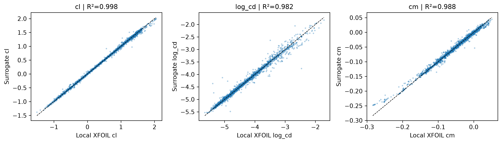
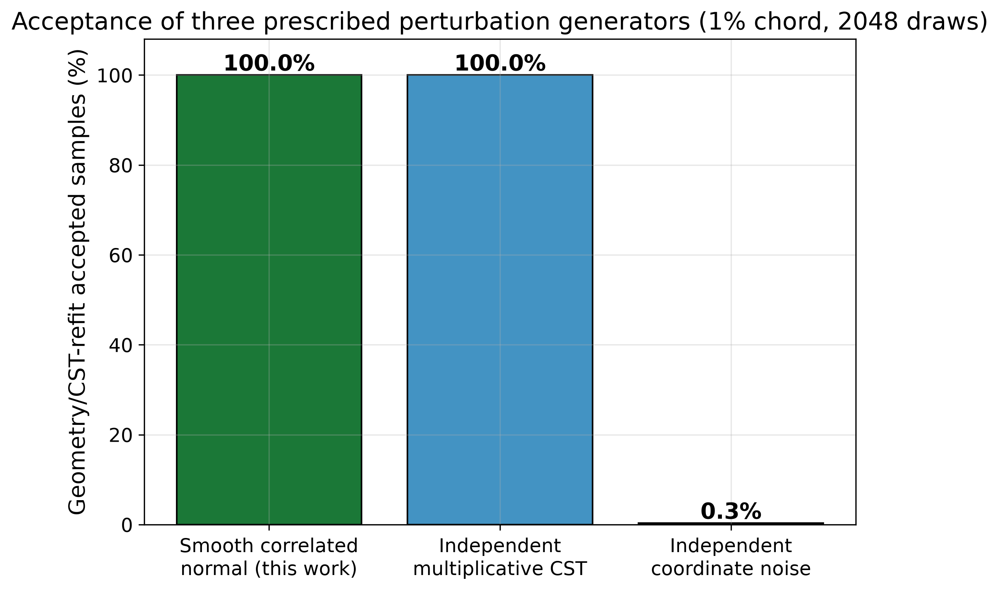
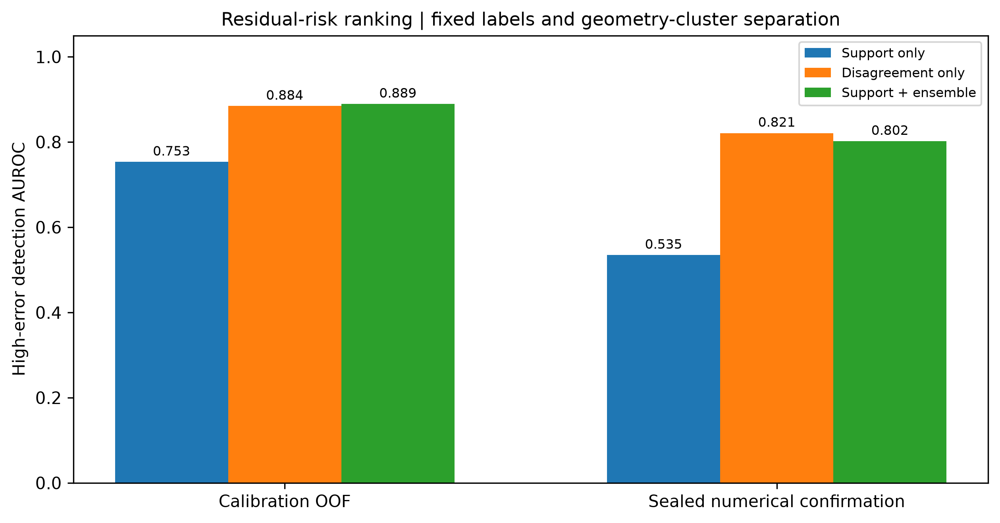
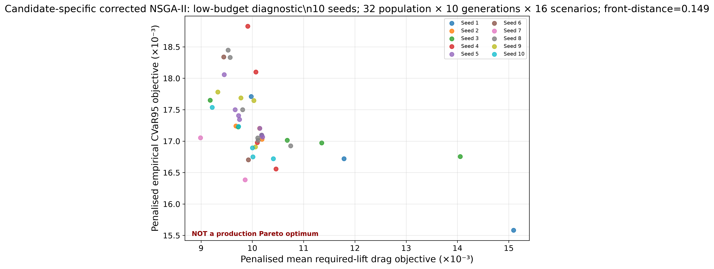
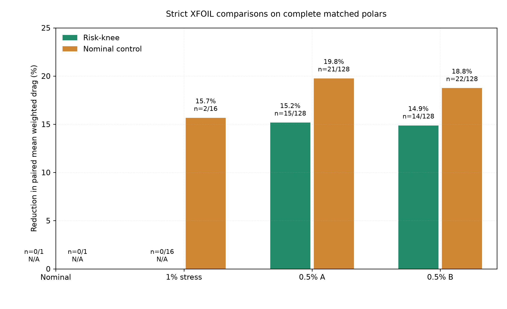
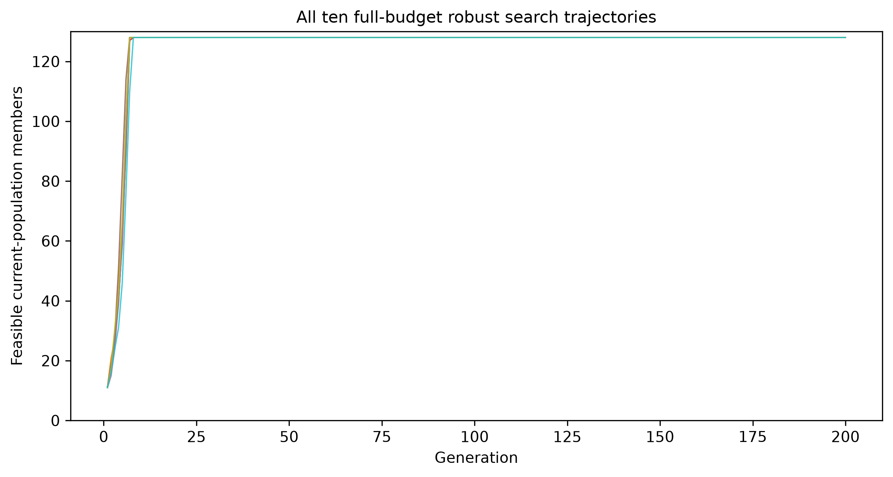
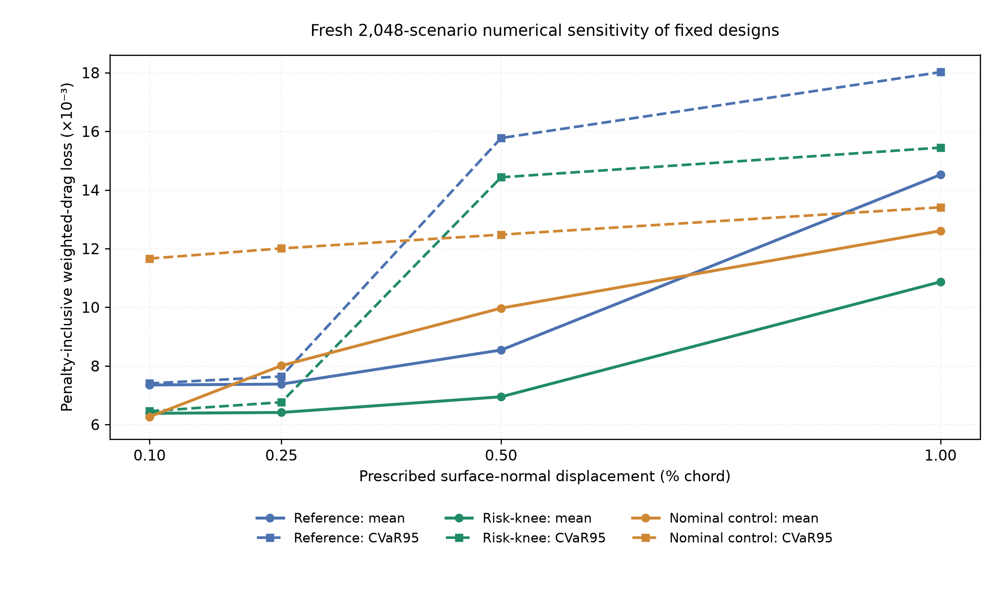
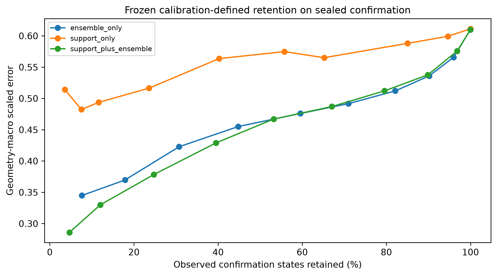

# Data-Driven Aerodynamic Prediction and Robust Aerofoil Selection: A Geometry-Consistent CST and XFOIL Study

## Authors

Benjamin Ian George Gawith; Ava Shahrokhi; Keivan Navaie

## Affiliations

Benjamin Ian George Gawith: School of Engineering, Liverpool John Moores University, Liverpool, UK. Ava Shahrokhi: Department of Maritime and Mechanical Engineering, Liverpool John Moores University, Liverpool, UK. Keivan Navaie: School of Computing and Communications, Lancaster University, Lancaster, UK.

## Corresponding Author

Ava Shahrokhi, A.Shahrokhi@ljmu.ac.uk

## Key Words

Aerodynamic prediction; Class–Shape Transformation; aerofoil optimisation; deep learning; surrogate modelling; numerical uncertainty; multi-objective design

## Highlights

- We resolve a geometry–polar mismatch before fitting and comparing aerodynamic surrogates.
- We assemble 106,931 exact-coordinate XFOIL observations and train five neural models on the 74,946-state development partition.
- We evaluate prediction and empirical reliability on both protected historical geometries and 200 prospectively sealed numerical test shapes.
- We complete ten independent robust and ten constrained nominal optimisation runs without reducing the declared search budgets.
- We retain all 819 strict selected-design solver attempts, including the 529 cases without usable aerodynamic comparisons.

## Abstract

Reliable surrogate-assisted aerofoil optimisation requires the model geometry to match the geometry used to calculate aerodynamic labels. We study robust section selection using a twelve-parameter Class–Shape Transformation (CST) representation, a five-member neural ensemble and prescribed geometric perturbations. Repairing coordinate order changed 1,001 of 1,560 historical encodings. Fresh XFOIL calculations on the admitted CST contours provided 106,931 of 141,928 requested states. On 15,179 observed protected test states, the ensemble achieved R² values of 0.9978, 0.9818 and 0.9882 for lift, logarithmic drag and pitching moment. A separate, prelabel-sealed 200-geometry confirmation supplied 17,968 observed states; disagreement-only error ranking achieved AUROC 0.821, compared with 0.802 for support plus disagreement and 0.535 for support alone. Forty geometry-distinct NACA-style sections provided a further 4,331 numerical observations. Ten robust and ten constrained nominal NSGA-II searches completed their full 128-individual, 200-generation budgets. Under the implemented incidence-averaged moment constraint and a fresh 1% geometric sensitivity field, the selected risk-knee had lower mean penalised loss than the reference (0.010867 versus 0.014520), although empirical trust penalties determined the upper-tail losses. Only 290 of 819 strict selected-design XFOIL attempts met the complete-polar requirements, leaving the nominal paired comparison unestimable. The study establishes a reproducible numerical route from geometry-consistent labels to failure-accountable design selection. Independent viscous CFD is required to assess the physical aerodynamic ranking.
## Nomenclature

| Symbol | Definition | Units |
|---|---|---|
| α | Angle of attack in the solver coordinate frame | degrees |
| C_L, C_D, C_M | Lift, drag and pitching-moment coefficients | dimensionless |
| x, y_u, y_l | Chordwise coordinate and upper/lower surface ordinates | chord fractions |
| A_u,i, A_l,i | Fourth-degree CST upper/lower Bernstein weights | dimensionless |
| Re, M, Ncrit | Reynolds number, Mach number and XFOIL transition parameter | dimensionless |
| ε | Prescribed maximum surface-normal displacement scale | chord fraction |
| J | Weighted drag at three required lift targets | dimensionless |
| CVaR95 | Mean of the upper 5% of the penalised scenario losses | objective units |
| P | Candidate- and scenario-set-dependent penalty for inadmissible cases | objective units |
| C̄_M | Mean pitching-moment coefficient over the 33 service incidences | dimensionless |
| d_s | Standardised nearest-development support distance | dimensionless |
| OOB | Out-of-bag development geometry validation | — |

## 1. Introduction

The design and optimisation of aerodynamic surfaces depend on an accurate account of how geometry influences aerodynamic forces. Even for a two-dimensional aerofoil, evaluating a large number of shapes across incidence and operating conditions requires repeated flow calculations. Wind-tunnel tests and high-fidelity computational fluid dynamics (CFD) provide valuable evidence, but their cost makes exhaustive shape exploration difficult in the early stages of design. Established viscous–inviscid methods provide a less expensive numerical alternative [1,10]. Standard treatments of aerofoil forces, geometry and operating conditions remain important when translating the resulting coefficients into engineering decisions [25,26].

Machine learning can reduce the cost of repeated aerodynamic evaluations. Reviews by Brunton and colleagues and by Li and colleagues describe its application to fluid mechanics and aerodynamic shape optimisation [2,3,5]. Li, Bouhlel and Martins demonstrated fast surrogate-based aerofoil analysis using RANS labels [4], while Shahrokhi and Jahangirian coupled surrogate models and evolutionary aerofoil optimisation with CFD [6,7]. Robust aerofoil design under geometric uncertainty has also been studied using neural approximations, Monte Carlo sampling and multi-objective optimisation by Ju and Zhang [30]. NeuralFoil provides a further relevant example of XFOIL-based learning, including aerodynamic coefficients and an explicit prediction-confidence measure [29]. These studies establish the value of surrogate prediction and robust optimisation. Our question is whether geometry-consistent labels, empirical prediction support and complete failure accounting lead to a reproducible and interpretable selection of a robust section for independent aerodynamic assessment.

We previously investigated predicting complete aerofoil lift curves using a compact geometry encoding and a neural network. The submitted manuscript used twelve CST parameters to represent a section and considered heterogeneous public XFOIL-labelled polar data. That work motivated the present study but cannot serve as unchanged evidence for it. During independent reproduction, we found that the coordinate ordering of two-block aerofoil files had been misinterpreted in many cases. Once corrected, 1,001 of the 1,560 previously encoded shapes changed. Moreover, fresh solver comparisons showed that a normalised or resampled version of an aerofoil could produce a different numerical polar at the same recorded incidence. A model fitted against the earlier labels could therefore be accurately predicting an inconsistent geometry–coefficient relationship.

These observations led us to reformulate the numerical experiment before drawing conclusions about robust design. We retain the archived dataset and its earlier model outputs for traceability, but generate a new controlled corpus in which every aerodynamic label is calculated on the exact CST reconstruction given to the model. The new surrogate predicts lift, drag and moment at individual incidences, allowing fixed required-lift objectives to be evaluated in optimisation. We then distinguish three questions that are often grouped together: how well the model predicts the numerical solver on existing geometries; whether a confidence or residual-risk screen identifies difficult predictions on independently labelled shapes; and whether optimisation outcomes remain consistent when the selected geometry is subject to prescribed shape perturbations.

The contributions of this paper are the following:

1. We reconstruct the source geometry and aerodynamic data, identify coordinate-order errors and demonstrate the need for exact geometry–label pairing.
2. We train and evaluate a five-member point-conditioned neural ensemble using new XFOIL labels, with geometry-cluster separation, development-only early stopping and calibration held apart from the protected historical test.
3. We assess empirical reliability using both support and ensemble disagreement, including 200 geometry-only selected confirmation shapes whose predictions were fixed before new numerical labels were generated.
4. We evaluate candidate-specific geometric deviations and compare ten-seed mean–CVaR95 optimisation with an equally budgeted constrained nominal control.
5. We test fixed selected designs using fresh, strict XFOIL calculations and report incomplete polars, failed required-lift intersections and all other adverse cases alongside the successfully evaluated pairs.

These elements form a single engineering study in which geometry, numerical prediction, design constraints and failed calculations remain linked to the selected sections. CST, neural ensembles and evolutionary robust design are established methods [8,9,13–16,27,29,30]. The contribution lies in the controlled evidence connecting them, particularly the distinction between predictive accuracy, repeatable numerical selection and the independent aerodynamic validation still required.

## 2. Aerofoil representation and numerical dataset

### 2.1 Class–Shape Transformation

The representation must be sufficiently compact for efficient learning while preserving the geometric variations relevant to section aerodynamics. We use the Class–Shape Transformation developed by Kulfan and Bussoletti [8,9]. Let x denote the chordwise coordinate, normalised such that the leading and trailing edges correspond to x = 0 and x = 1. Both surfaces are represented by a shared class function and a Bernstein polynomial shape function. In the implemented fourth-degree representation,

C(x) = x^(1/2) (1 − x), and B_i(x) = binomial(4,i) x^i (1 − x)^(4−i), i = 0,…,4.

The ten primary coefficients consist of five lower-surface weights and five upper-surface weights. A common leading-edge modifier is defined using L(x) = C(x) exp(−20x), and the final parameter specifies nonnegative trailing-edge thickness. The actual implemented reconstructions are

y_u(x) = C(x) ∑_(i=0)^4 [A_u,i B_i(x)] + A_LE L(x) + (t_TE/2)x

y_l(x) = C(x) ∑_(i=0)^4 [A_l,i B_i(x)] − A_LE L(x) − (t_TE/2)x

These expressions specify the actual twelve-component feature vector. In particular, the leading-edge modifier is not interchangeable with an additional standard Bernstein coefficient. We fit the source coordinates using least squares, and if an unconstrained fit produces a negative trailing-edge thickness we resolve the remaining coefficients with t_TE fixed to zero. Reconstructed upper and lower surfaces are checked for surface crossing, physical area and maximum fitting error. We use common cosine-spaced surface coordinates when evaluating both the nominal section and perturbed geometries.

The CST fit is still an approximation to the originally downloaded coordinates. This distinction matters when assigning aerodynamic targets. A coefficient generated on an unmodified source contour should not automatically be attributed to a rotated, resampled or fitted contour. We therefore generate the controlled aerodynamic labels on the saved CST geometry itself. Figure 2 summarises the numerical observation coverage arising after this definition is enforced.

### 2.2 Audit of the original sources

The inherited archive contained 1,560 recorded aerofoils and 179,780 numerical states, with source contours originally attributed to the University of Illinois Urbana–Champaign (UIUC) Airfoil Data Site and aerodynamic polars to Airfoil Tools [11,12]. These are provenance statements about the historical files, not a claim that the public websites were used to regenerate the final controlled labels. The original coordinates included multiple conventions, notably two-block Lednicer-style and trailing-edge-to-trailing-edge Selig-style ordering. A reader that assumes the wrong order can produce two smooth-looking but physically different surfaces; an error of this kind may not be obvious from a well-fitted low-dimensional feature vector.

Our audit corrected the coordinate ordering and refitted all available shapes. The ordering repair changed 1,001 of the 1,560 historical feature vectors. The later nonnegative trailing-edge fit also changed 239 Selig-contour encodings. After the complete geometry checks, 1,256 candidate reconstructions were admitted. We also compared selected archived labels against fresh local solver calculations on the original and normalised coordinates. For the AG35 section, the raw-coordinate and archived lift coefficients had an RMS difference of about 0.00127 on the six matched incidence points, whereas the corresponding normalised-coordinate comparison differed by about 0.173. This is an illustrative frame check, not a statistical estimate across the full dataset. It demonstrates why a geometry parser repair alone cannot certify the physical interpretation of the original labels.

Rather than applying an uncertain analytical correction to the archived coefficients, we retain that corpus as a separate historical lineage and construct the new one from fresh numerical observations. The historical results are never reclassified as prospective tests of the rebuilt model.

### 2.3 Exact-coordinate aerodynamic labels

For each of the 1,256 admitted CST shapes, we run the local XFOIL 6.99 executable at Re = 1,000,000, M = 0 and Ncrit = 9. We request two directed incidence sweeps, from 0° to 16° and from 0° to −12°, both at 0.25° steps, with a fixed 200-iteration solver limit and bounded execution time. The union contains 113 distinct incidences per section and a total of 141,928 requested states.

Only actual printed coefficients from clean, zero-exit, non-timeout runs enter the supervised dataset. Each admitted row must have finite lift, drag and pitching moment, with strictly positive drag. Consistent duplicate observations at zero incidence are merged once; conflicting observations and missing values are not used. A case that returns only part of a polar contributes the genuinely observed points, but is not described as a complete sweep. This policy preserves both model reproducibility and information about the solver's convergence selection.

**Table 1. Controlled aerodynamic observations and protected geometry partitions.**

| Partition | Aerofoils with observations | Geometry clusters | Admissible states |
|---|---:|---:|---:|
| Development | 858 | 850 | 74,946 |
| Calibration | 191 | 189 | 16,806 |
| Protected historical test | 175 | 173 | 15,179 |
| Total observed | 1,224 | 1,212 | 106,931 |
| All requested states | 1,256 geometries | — | 141,928 |

The controlled runs provide 106,931 usable states; 34,997 of those requested are missing or fail admission. Only 44 of the 1,256 sections have a complete 113-point polar. Consequently, prediction accuracy calculated on the available rows is conditional on numerical convergence and cannot be extrapolated to regimes for which the solver failed. This limitation becomes particularly important when subsequent design selection asks the surrogate to explore unfamiliar geometries.

### 2.4 Geometry partitions and data independence

We separate data by geometry identity rather than selecting individual incidence points at random. Near-duplicate reconstructed contours are clustered with a fixed RMS geometry tolerance of 10⁻⁴ chord. Where a reconstructed cluster overlaps an older identity, the most protected partition designation is inherited: protected historical test first, calibration second, development last. This prevents a corrected or aliased contour appearing in training when an earlier form of that same shape was assigned to the protected test.

The resulting development, calibration and protected partitions are shown in Table 1. Their assignment is fixed before numerical labels are used for training. These are meaningful protections against repeated-shape leakage, although the historical section identities had already been examined during the preceding audit; the final test is therefore a protected retrospective test rather than a pristine, newly acquired external population.

### 2.5 Operating mission and aerodynamic constraints

We specify one subsonic numerical mission rather than optimising over unrelated operating conditions. The surrogate input contains twelve CST coefficients plus incidence α in degrees. The output comprises the dimensionless lift coefficient C_L, the natural logarithm of positive drag C_D, and the pitching-moment coefficient C_M. The three target lift coefficients are 0.4, 0.7 and 1.0, with respective weights 0.25, 0.50 and 0.25. Drag at a required lift is found by interpolation only where exactly one admissible crossing lies on the initial rising branch of the polar over the declared service range 0°–8°. We do not extrapolate beyond the service range or treat a later post-stall rise as a second valid design condition.

For a candidate with all three required lift roots, the nominal objective is

J = 0.25 C_D(C_L = 0.4) + 0.50 C_D(C_L = 0.7) + 0.25 C_D(C_L = 1.0).

Missing or ambiguous roots make the candidate infeasible under this fixed mission. Thickness, section area, leading-edge radius and pitching moment are constrained relative to the reference shape. The moment condition used in the completed searches is the arithmetic-mean bound

C̄_M(p) ≥ C̄_M(ref) − 0.01.

The mean includes the 33 service incidences from 0° through 8° at 0.25° intervals. It limits average nose-down moment relative to the reference; it does not require the bound to hold at every incidence. A reduced drag coefficient alone is therefore insufficient to establish an admissible design.

**Table 2. Reproducible geometry and aerodynamic design definitions.**

| Property | Prescribed value | Interpretation |
|---|---|---|
| CST geometry | Five lower + five upper weights, leading-edge modifier, trailing-edge thickness | Twelve design features |
| Surrogate incidence input | Angle of attack in degrees | Thirteenth neural input |
| XFOIL labels | Re = 10⁶; M = 0; Ncrit = 9 | One numerical operating domain |
| Required lift | 0.4, 0.7 and 1.0 | Unique initial-rising-branch roots |
| Mission weighting | 0.25, 0.50 and 0.25 | Nominal weighted drag coefficient |
| Service incidence interval | 0°–8° | 33 points at 0.25° increments |
| Moment constraint | Mean C_M ≥ mean reference C_M − 0.01 | Mean over all 33 service incidences; not a pointwise bound |
| Robust objectives | Mean J and empirical CVaR95(J) | Failure-penalised sampled quantities |

## 3. Data-driven aerodynamic model and empirical reliability

### 3.1 Point-conditioned neural surrogate

We formulate aerodynamic prediction as a function of shape and operating incidence, rather than forcing every section onto a fixed-length, fully imputed lift curve. For each observed numerical state, the input is the twelve-component CST vector followed by the recorded angle of attack. The output is a three-component prediction of C_L, log(C_D) and C_M. Predicting the logarithm of positive drag is useful because drag can vary over a wider relative range than lift or moment, particularly across the observed incidence domain. Exponentiating the predicted logarithmic drag gives the coefficient used for design evaluation.

Five neural members share an identical point-conditioned architecture. Each has a 13-input projection, a hidden width of 512, two residual blocks and three output heads. The fixed configuration uses rectified linear units [19], dropout of approximately 0.122 and about 1.06 million trainable parameters per member. Training uses AdamW [18] in PyTorch [20]. The inherited architecture and its development-only hyperparameter-selection record, including Optuna [21], are preserved; we do not repeat architecture search using the new calibration or protected test labels. This distinction is important because a favourable result after searching the protected test would no longer be an independent assessment of that selected architecture.

Each member draws a distinct geometry-level bootstrap sample from the development partition, with its own random seed. Scaling is fitted to the corresponding training data, and an out-of-bag set of development geometry clusters supplies the stopping criterion. We train for at most 300 epochs with patience of 25 epochs, saving the best development validation checkpoint. The five completed runs used 169, 100, 300, 264 and 182 epochs, with development-selected best epochs of 144, 75, 284, 239 and 157. The calibration and protected historical test data do not select those stopping epochs. Input/target masks prevent unavailable numerical labels being treated as measured zero values, and geometry-balanced sampling avoids making the longest numerical polar the only determinant of training weight.

The ensemble mean supplies the coefficient prediction. We use the between-member variation as one empirical indication of prediction instability rather than as a direct probability distribution over true aerodynamic forces. Deep-ensemble disagreement is a recognised uncertainty heuristic [16]; five predictors trained on overlapping data can share systematic errors and cannot independently establish calibrated uncertainty.

For context, we also fit fixed ridge-regression, histogram-based gradient-boosting and mean-prediction baselines to the same admitted development labels, using scikit-learn [24]. The data processing, array operations and numerical algorithms rely on NumPy and SciPy [22,23]. Baseline results are reported on the same protected numerical states; they are not trained on the protected test to improve their comparison.

### 3.2 Empirical trust domain and residual bands

A low average error does not tell us whether a particular optimised shape is supported by the available development data. We therefore retain an empirical domain screen that considers the standardised nearest-development support distance, the output-specific between-member spread and permitted incidence. Thresholds and residual-band widths are fitted on the separate controlled calibration partition. The operational spread thresholds equal the largest spread observed for each target in that partition, making them calibration-envelope limits. On the protected test, these limits add no rejections beyond the support-distance rule. The screen classifies individual *predicted numerical states* and does not certify an entire polar or section.

Let the residual of target k on a calibration observation be e_k = y_k − ŷ_k. Output-specific absolute residual quantiles provide descriptive marginal error bands around the corresponding predicted coefficient. We evaluate coverage both at the observation level and after equal weighting of complete observed geometries. These bands are empirical rather than claimed conditional conformal intervals. Ordinary conformal calibration relies on assumptions about exchangeability and data selection [17], and feedback from an optimiser can change the evaluated input distribution [28]. We accordingly avoid presenting accepted-subset or adaptively selected-design coverage as if such a guarantee had been proved.

### 3.3 Geometry-grouped residual-risk assessment

The operational trust rule identifies states outside the accepted development support. To test whether ensemble spread provides further information about numerical prediction errors, we conduct a separate calibration-only residual-risk ranking experiment. Within the calibration geometries, five grouped folds keep reconstructed geometry clusters disjoint between each risk-model training fold and its out-of-fold assessment. The fitted features include standardised support distance, ensemble spread and their combination. Error-scale definitions and upper-decile high-error labels are derived from the calibration training folds alone.

We compare three ridge-ranking models: support alone, disagreement alone and support plus disagreement. The evaluation statistic is the area under the receiver-operating-characteristic curve (AUROC) for ranking the frozen high-error labels. Average precision and equal-geometry weighting are also retained in the evidence. To indicate sampling sensitivity, a geometry-cluster bootstrap is applied to the already fitted out-of-fold scores. This is a descriptive fixed-model interval, not a full repetition of network training, hyperparameter selection and aerodynamic data acquisition.

The operational trust screen is not modified on the basis of the ranking study. It remains possible for the combined model to outperform support alone on calibration data yet perform less well than disagreement alone on a genuinely new set of geometries. We assess that possibility separately rather than selecting a preferred ranking signal after seeing the final design outcomes.

### 3.4 Sealed geometry confirmation before new solver labels

We construct a second numerical test in order to evaluate the frozen predictor on geometries that were not used to train, stop or calibrate its aerodynamic response. Before the controlled model is trained, 200 new CST parameter vectors are generated by fixed-seed convex mixtures of two different development shapes. All are screened for geometric validity and separation from the historical and already selected geometries; their exact vectors and file hashes are sealed. Selection uses only source geometry, not future XFOIL coefficients.

Following ensemble training and calibration-only risk fitting, we evaluate the 200 shapes at the full 113-point incidence grid. The predictions, empirical screen decisions, residual-risk scores and fitted thresholds are written and hash-frozen *before* any of the corresponding confirmation XFOIL runs. We then run the original prescribed solver protocol on the exact sealed coordinates, retain every failure or missing incidence, and join observations to predictions using both geometry identity and incidence. This ordering limits direct selection and fitting leakage for the confirmation outcomes.

This cohort should not be mistaken for a new distribution of unrelated aerofoil families. Its members are convex mixtures of development geometries and may remain statistically dependent on their source parents. Moreover, XFOIL generates both training and confirmation labels. The experiment tests prospective generalisation of the fixed numerical predictor on deliberately held-back geometries, not independent CFD or physical aerodynamic truth.

## 4. Uncertainty-aware aerodynamic optimisation

### 4.1 Definition of prescribed geometric variation

Manufactured sections differ from a nominal design through finite geometric deviations. The nature of those deviations depends on material, process, tolerances and inspection data; none of those manufacturing measurements is available for the present study. Instead, we use a controlled sensitivity model to test the behaviour of the surrogate and optimisation procedure under plausible *mathematical* changes to the surface. We do not assign measured manufacturing probabilities to the resulting scenarios.

The perturbation field is applied in the local surface-normal direction at 201 cosine-spaced points on each actual candidate surface. Eight controls per surface are sampled using scrambled Sobol sequences, interpolated with a finite chordwise correlation length of 0.15 chord, and tapered at the leading edge while displacement is set to zero at the trailing edge. The declared upper/lower latent correlation is zero, although within-surface deviations remain spatially correlated through the interpolation. Nominal amplitudes of 0.1%, 0.25%, 0.5% and 1% chord are used as sensitivity levels. The numerical generator, scrambling seeds, amplitude definitions and refit tolerances are retained with the evidence archive.

A previous implementation used a reference-shape increment when evaluating a different candidate. That operation would have assessed a displacement of the reference instead of the candidate's own geometry. The corrected procedure reconstructs *each candidate's* upper and lower surfaces, applies the spatially correlated normal displacement to those coordinates, verifies that the perturbed surfaces remain valid, fits the displaced shape back to the twelve-parameter CST representation and verifies the refit accuracy before passing it to the surrogate. A refit tolerance of 0.005 chord was selected through earlier numerical sensitivity checks and fixed before the production search; it is not represented as a measured manufacturing allowance.

### 4.2 Aerodynamic objectives and failed scenarios

For each valid perturbed candidate, we compute a polar over the prescribed service domain and extract drag only where all three required lift values have unique crossings on the initial rising branch. The nominal weighted coefficient J is defined in Section 2.5. The robust sample objective includes explicit penalties for invalid displaced geometry, unacceptable CST refits, unavailable required-lift roots or an empirical trust-domain violation. Let V(p,S) be the admissible scenarios for candidate p in the current finite scenario set S. The implemented penalty is

P(p,S) = 2 max{J_s(p) : s ∈ V(p,S)} if V(p,S) ≠ ∅; otherwise P(p,S) = 1.

For each scenario, the numerical loss is

L_s(p) = J_s(p) if s ∈ V(p,S), and L_s(p) = P(p,S) otherwise. Thus the penalty is computed separately for each candidate and scenario set; it is neither a common physical drag value nor a measured failure cost.

We minimise the arithmetic mean of L_s and its empirical CVaR95, calculated as the upper-five-percent mean of these finite scenario losses [15]. Fractional probability at the empirical tail boundary is retained. Since P exceeds every admissible J_s, a scenario set with at least 5% inadmissible outcomes has CVaR95 equal to the candidate's penalty. The objective therefore combines predicted drag and failure of the numerical trust or feasibility rules. Its upper tail must be interpreted with the accompanying failure counts, particularly because the prescribed perturbations are not a measured manufacturing distribution.

The nominal constraints require a thickness ratio of 0.98–1.02 relative to the reference, a section area ratio of at least 0.98, a leading-edge radius proxy ratio of at least 0.80, and the service-mean pitching-moment allowance defined in Section 2.5. Geometry validity, empirical trust throughout the service grid and all three unique required-lift roots are also necessary. The moment criterion is evaluated over the 33 incidence points as a mean, with no additional pointwise moment restriction.

### 4.3 Independent seeded NSGA-II study

We solve the two-objective problem using the NSGA-II method of Deb and colleagues [13], implemented through pymoo [14]. The production budget is fixed at 128 individuals, 200 generations, 64 common uncertainty samples and ten independent algorithm seeds. All ten seeds are included whether or not their returned fronts are favourable. Each generation is checkpointed, and its population size, objective values, feasibility counts, numerical invalidity and evaluation history are retained in reproducible receipts.

We evaluate algorithm agreement using the original numerical criterion: at least eight of ten seeds must yield feasible solutions and the mean pairwise normalised distance between feasible seeded fronts must not exceed 0.20. A limitation of the earlier reporting method was that the objective normalisation used the ranges of the solutions found *after* the optimisation. We retain that pooled-range calculation as a historical diagnostic and separately report a reference-scaled distance whose positive scales are fixed before the search. Reporting both avoids retrospectively changing the scale to secure a pass.

An algorithmically stable front is not proof of a global Pareto optimum. In particular, the model itself is approximate, the scenario set is finite, the empirical screen rejects some numerical states and the physical manufacturing distribution is unknown. We therefore limit the optimisation claims to the actual candidate, solver and algorithm budgets that have been executed.

### 4.4 Matched constrained nominal control

To establish a meaningful comparison, we run a separate nominal-only search with ten distinct seeds, again using 128 individuals and 200 generations. The control minimises nominal weighted drag J subject to the same reference, geometry bounds, 33-point service domain, service-mean moment restriction and empirical screen. The nominal procedure does not incur 64 perturbed evaluations for every candidate, so the two studies have matched *evolutionary budgets* rather than identical total neural inference cost.

The final robust and nominal populations are evaluated and retained using their own frozen objectives and constraints. A deterministic geometry tie-break is used when selecting from equal-score feasible candidates. The risk-knee design is chosen from the pooled feasible non-dominated robust front by its fixed reference-scaled distance to the feasible ideal. The nominal control minimises nominal weighted drag across all feasible final nominal populations. Minimum-mean and minimum-tail candidates are retained as additional diagnostics. No fresh selected-design XFOIL result is used to choose these finalists.

### 4.5 Fresh scenarios and strict selected-design verification

After fixed finalist selection, we evaluate the chosen geometries under newly scrambled sets of 2,048 latent perturbations at each of four prescribed amplitudes. These scenarios are distinct from the 64 common samples that formed the optimisation objectives. We record their penalty-inclusive mean and CVaR95, along with invalid geometry, fit and lift-root cases. They are a numerical sensitivity test of fixed models and designs, not a Monte Carlo validation of real manufacturing deviations.

We also run fresh local XFOIL directly on saved coordinates for the reference, nominal control and risk-knee sections, including perturbed surfaces. The strict verification request uses 45 incidence points from 0° to 11° in 0.25° steps, preceded by a warm-up sequence, with 200 solver iterations and a bounded runtime. A case is usable only when every required point is present from a clean run, all coefficients are finite with positive drag, and the three lift targets have unique admissible roots in 0°–8°. The inability to evaluate one or more roots is recorded as a failure, not assigned a nominal drag value. All 819 scheduled cases must be accounted for and the paired comparison is computed only when the reference and candidate are *both* usable under the same sampled perturbation.

This verification is purposely stricter than accepting whichever points happen to converge. It tests the selected design's numerical evidence quality as well as its apparent aerodynamic performance. However, it uses the same family of viscous–inviscid numerical method as the training data and is not an independent RANS CFD or experimental check. We reserve that separate physical-model validation for Section 7.

## 5. Results and numerical assessment

### 5.1 Controlled aerodynamic prediction

The controlled source-to-label audit yields 106,931 valid XFOIL states from 1,224 reconstructed sections. Of these, 74,946 development observations are assigned to 858 aerofoils, 16,806 calibration observations to 191 aerofoils, and 15,179 protected historical test observations to 175 aerofoils. The remaining requested solver states are absent or ineligible and are not included in the numerical error denominator. The model freeze, feature scalers and calibration rule are bound to their exact source and data identities.

Table 3 compares the neural ensemble with two simple baselines on the common protected numerical test. We compute the usual coefficient of determination R² and mean absolute error (MAE) on observed states, and also report a geometry-macro MAE that gives each evaluated shape equal importance. For drag, the model is trained on log(C_D); we additionally reconstruct C_D in linear units to show the effect of the logarithmic transformation.

**Table 3. Prediction accuracy on the 15,179 observed numerical states in the protected historical test.**

| Target | Ensemble R² | Ensemble MAE | Geometry-macro MAE | Ridge R² | Gradient-boosting R² |
|---|---:|---:|---:|---:|---:|
| C_L | 0.9978 | 0.02205 | 0.02185 | 0.9656 | 0.9933 |
| log(C_D) | 0.9818 | 0.04737 | 0.05123 | 0.1628 | 0.9518 |
| C_M | 0.9882 | 0.00331 | 0.00320 | 0.8966 | 0.9587 |
| C_D (linear) | 0.9444 | 0.00132 | 0.00135 | — | — |

The ensemble provides low observed-state errors for this specific numerical data distribution. In particular, the lift and moment R² values are high, although the linear drag R² of 0.9444 is lower than the logarithmic drag R² of 0.9818. Figure 1 compares predicted and actual coefficients without interpreting the sampled pointwise agreement as independent experimental validation.

The result must not be presented as a percentage improvement over the model trained on the original archived polars. The new experiment changes both the admitted geometries and the precise coordinate–label relationship. It is more internally consistent, but its test set is not an identical aerodynamic benchmark. Moreover, solver convergence determines which states are available to score; extrapolation to the 34,997 missing controlled states remains unmeasured.

### 5.2 Empirical reliability and numerical confirmation

The calibration-derived empirical screen accepts 9,913 of the 15,179 observed test states and rejects 5,266, all by support distance. Its output-specific spread thresholds are the calibration maxima: 0.19490 for C_L, 0.61600 for log(C_D) and 0.03441 for C_M. They contribute no further protected-test rejections. Observed-state residual-band coverage is 96.8% for C_L, 95.9% for log(C_D), and 97.7% for C_M when all admissible test states are counted. These are measured marginal coverage fractions for fixed observed numerical labels. They do not establish conditional prediction coverage for every accepted state, a simultaneous band over an entire polar, or a coverage guarantee for a shape selected by the optimiser.

The separate geometry-cluster out-of-fold study provides a more direct test of whether the risk features identify high-error cases. On the calibration data, the support-only classifier has AUROC 0.753, while support combined with ensemble disagreement reaches 0.889. An ensemble-disagreement-only classifier reaches 0.884. The combined-minus-support increment is 0.136, with a fixed out-of-fold geometry-bootstrap 95% interval of approximately [0.091, 0.200]. This interval conditions on the fitted out-of-fold scores; it does not include uncertainty from retraining all neural models.

We then check the frozen scores against newly computed labels for the 200 sealed confirmation shapes. XFOIL supplies 17,968 of 22,600 requested states. The remaining 4,632 states lack admissible solver truth. On the observed subset, the combined risk model has AUROC 0.802, compared with 0.535 for support distance alone. The difference is 0.267, with a fixed-model geometry-bootstrap interval of approximately [0.200, 0.340]. Crucially, the disagreement-only score achieves AUROC 0.821 on this same cohort, which is *higher* than the combined score. We therefore do not claim that the combined score is the best available detector of numerical error.

**Table 4. Calibration-only risk ranking and prospective numerical confirmation.**

| Evaluation cohort | Support-only AUROC | Disagreement-only AUROC | Combined AUROC |
|---|---:|---:|---:|
| Geometry-cluster calibration OOF | 0.753 | 0.884 | 0.889 |
| Sealed 200-geometry confirmation | 0.535 | 0.821 | 0.802 |

Table 4 and Figure 3 separate the retrospective calibration-fold ranking from the sealed prelabel confirmation. The latter is more relevant to the frozen ranking features, but it remains a controlled interpolation-style numerical experiment on mixtures of known source geometry. Because failures of the solver do not provide truth for the missing states, no AUROC, MAE or band coverage can be assigned to those states without further independent measurements. The screen is therefore left in its previously frozen operational form rather than retuned to the favourable confirmation subset.

### 5.2.1 Geometry-distinct numerical generalisation challenge

To assess whether the fixed model remained usable beyond mixtures of known development geometries, we constructed a separate, reproducible numerical challenge using 40 analytically generated four-digit NACA-style sections. Each was represented by the same twelve CST features, screened for admissible surface geometry, and required to remain at least 0.002 chord RMS from all 1,256 admitted training-corpus geometries, with the same separation among new sections. Geometry identities and model predictions were fixed before new XFOIL labels were generated. These shapes had no part in training, stopping, calibration or optimiser candidate selection.

The independent case audit accounts for all 40 sections and all **4,520 requested numerical states**. XFOIL provides 4,331 usable observations and leaves 189 without admissible labels. On the observed subset the frozen ensemble achieves MAEs of 0.019656 in C_L, 0.000636 in C_D and 0.004087 in C_M. Its unchanged empirical trust rule accepts 2,248 observed states and rejects 2,083. Lift MAE is 0.01533 on the accepted subset versus 0.02432 on the rejected subset; moment MAE is 0.00317 versus 0.00507, but drag MAE is 0.000711 versus 0.000556. This mixed result provides a check of numerical transfer and helps identify where the trust screen is incomplete; it is not evidence of uniformly reliable drag screening.

The NACA-style family was constructed after the original study and is therefore **a post hoc geometry-separated numerical challenge**, not a preregistered external population test. Its labels also come from XFOIL, not independent CFD. Results and source-hash receipts are kept outside the original frozen confirmation and design selection, with the complete case ledger available for reconstruction.

### 5.3 Reproducibility of the robust search

The full robust optimisation budget consists of ten completed independent seeds, each with 200 generations of 128 individuals and 64 candidate-specific uncertainty samples. The completed generation receipts independently reconcile to 2,000 generations and 256,000 candidate evaluations. All ten seeds produce feasible final entries under the declared numerical constraints; 371 feasible final designs are recorded in their reported final solution sets. Neither infeasible intermediate candidates nor failure-penalty contributions are discarded from the generation histories.

The reference geometry has the pre-run mean and empirical-tail objectives of approximately 0.01209 and 0.01638, respectively, under the fixed numerical profile. The mean cross-seed distance after scaling by predeclared reference objectives is 0.0243. The historical pooled-range distance is 0.1029. Both lie below the numerical tolerance of 0.20, and all ten seeds have feasible final solutions, exceeding the minimum eight-seed requirement. Thus, the completed implementation **passes both declared finite-budget agreement diagnostics**. Figure 4 shows the feasible design fronts and Figure 6 shows the actual generation histories, not an idealised convergence curve.

A pass on these metrics establishes repeatability within the specified algorithm, surrogate, service conditions and finite perturbation profile. It is not a proof that the returned point is globally optimal, that the search sampled every manufacturing scenario, or that independent aerodynamic solvers would order the shapes identically. Those are separate questions.

The matched nominal-only control also completes ten independent 128 × 200 searches with the unchanged nominal constraints. All ten control seeds yield feasible results. The minimum recorded feasible nominal weighted drag is approximately 0.00574, compared with the robust study's minimum feasible *penalty-inclusive mean* of approximately 0.00855. These quantities use different objectives and cannot be subtracted to claim the robust optimiser is aerodynamically inferior or superior. The relevant comparison is between the fixed final designs under a common evaluation and, subsequently, an independent solver.

**Table 5. Completed robust and constrained nominal optimisation searches.**

| Property | Robust mean–CVaR95 search | Constrained nominal-only control |
|---|---|---|
| Independent optimisation seeds | 10 | 10 |
| Population and generations per seed | 128 × 200 | 128 × 200 |
| Perturbation states per robust candidate | 64 | No perturbation objective |
| Seeds with feasible final designs | 10 | 10 |
| Full-profile completion | All 2,000 generations | All 2,000 generations |
| Minimum recorded feasible objective | 0.00855 (penalised mean) | 0.00574 (nominal weighted drag) |
| Common design constraints | Geometry, required lift, service-mean moment and trust | Same nominal constraints |
| Predeclared front-agreement criterion | Pass under both numerical scales | Not an identical two-objective criterion |

We retain the distinction between nominal drag and penalty-inclusive robust loss. The moment constraint is also important to interpreting feasibility: the reference mean C_M is −0.051967, so the implemented lower mean bound is −0.061967. The selected risk-knee and nominal control have mean values of −0.060804 and −0.061965, respectively, and both pass that bound. On the five original 0°, 2°, 4°, 6° and 8° incidences, the risk-knee also passes the analogous pointwise bound, whereas the nominal control exceeds it at 6° and 8° by 0.004877 and 0.002805. The completed comparison therefore concerns designs constrained in mean moment, not designs certified against a pointwise moment requirement.

### 5.4 Fresh perturbation sensitivity of fixed designs

After fixing the design identities, we evaluate each of the reference, risk-knee and constrained nominal-control sections under four fresh sets of 2,048 Sobol-derived geometric disturbances. These samples are independent of the 64 scenarios used in optimisation. Table 6 and Figure 7 give the complete primary-design results under the same amplitudes and penalty rule.

**Table 6. Fresh fixed-design numerical sensitivity; mean and CVaR95 are candidate-dependent penalty-inclusive weighted-drag losses.**

| Amplitude (% chord) | Design | Mean loss | Empirical CVaR95 | Trust exits / 2,048 |
|---|---|---:|---:|---:|
| 0.10 | Reference | 0.007349 | 0.007402 | 0 |
| 0.10 | Risk-knee | 0.006382 | 0.006455 | 0 |
| 0.10 | Nominal control | 0.006267 | 0.011661 | 180 |
| 0.25 | Reference | 0.007379 | 0.007639 | 2 |
| 0.25 | Risk-knee | 0.006412 | 0.006760 | 2 |
| 0.25 | Nominal control | 0.008008 | 0.012007 | 733 |
| 0.50 | Reference | 0.008540 | 0.015771 | 272 |
| 0.50 | Risk-knee | 0.006946 | 0.014433 | 119 |
| 0.50 | Nominal control | 0.009969 | 0.012477 | 1,269 |
| 1.00 | Reference | 0.014520 | 0.018019 | 1,362 |
| 1.00 | Risk-knee | 0.010867 | 0.015445 | 982 |
| 1.00 | Nominal control | 0.012607 | 0.013409 | 1,823 |

All twelve primary-design scenario sets have zero geometry/refit failures and zero missing-lift-root failures; their inadmissible losses arise from the empirical trust screen. At 0.5% and 1% chord, every reported CVaR95 is entirely the candidate-specific penalty. At 1% the risk-knee has a lower mean loss than both the reference and nominal control, but the nominal control has a smaller CVaR95 despite its larger number of trust exits. This follows directly from the candidate-dependent penalty scale. The mean values indicate useful numerical selection behaviour under this prescribed field, while the tail values cannot be interpreted as measured manufacturing-risk reductions.

### 5.5 Strict selected-design XFOIL verification

We next use the actual displaced coordinates, rather than the surrogate refits, for fresh local XFOIL checks. The predeclared programme contains three nominal cases and three sets of perturbation tests for each of the reference, risk-knee and constrained nominal-control designs. In total, 819 fixed cases are attempted, all with clean process exits and no timeouts. Of these, 290 satisfy the complete-polar and required-lift-root conditions. The remaining 529 consist of 527 cases failing strict polar admission and two further cases without all required lift roots. The nominal reference, risk-knee and nominal-control runs do not all provide the complete strict polar. Accordingly, **no matched strict nominal drag percentage is estimable**. We do not borrow a favourable nominal value from the historical pre-repair experiment or infer a drag coefficient for any failed case.

For the 0.5% chord scenario set A, fifteen complete reference–risk-knee pairs give a 15.2% reduction in paired mean weighted drag. Scenario set B has fourteen such pairs, with a corresponding mean reduction of 14.9%. These percentages are conditional on both members of a pair having a usable strict numerical polar. For comparison, the constrained nominal-only design gives 19.8% and 18.8% mean reductions on its 21 and 22 matched pairs from the two 0.5% sets. We do not select between these designs by excluding cases that failed for one candidate. At the more severe 1% setting there are zero usable matched reference–risk-knee pairs, so no robust-design drag-reduction estimate is defensible there; the nominal-control comparison has only two complete matched pairs and is too sparse to support a population-tail conclusion.

**Table 7. Strict local-XFOIL comparisons, conditional on complete reference and candidate polars. The percentage is 100 times the difference of paired mean weighted drags divided by the paired reference mean.**

| Prescribed scenario and selected comparator | Complete matched pairs | Mean paired weighted-drag reduction | Largest reference / candidate drag among paired cases |
|---|---:|---:|---|
| Nominal, risk-knee | 0 | Not estimable | Not estimable |
| Nominal, nominal-only control | 0 | Not estimable | Not estimable |
| 1% chord, risk-knee | 0 | Not estimable | Not estimable |
| 1% chord, nominal-only control | 2 | 15.7% | 0.00880 / 0.00766 |
| 0.5% chord set A, risk-knee | 15 | 15.2% | 0.00860 / 0.00721 |
| 0.5% chord set A, nominal-only control | 21 | 19.8% | 0.00862 / 0.00704 |
| 0.5% chord set B, risk-knee | 14 | 14.9% | 0.00814 / 0.00695 |
| 0.5% chord set B, nominal-only control | 22 | 18.8% | 0.00846 / 0.00745 |

The 819 cases are not a representative sample of all possible physical manufacturing defects. Numerical convergence itself selects the subset on which a paired coefficient can be measured. In particular, it would be misleading to treat the 15 or 14 successful pairs as an unbiased sample of 128 attempted deviations, or to interpret their maxima as a valid CVaR95 estimate for the entire prescribed population. Figure 5 labels the conditional matched-pair counts against their total attempted scenarios. The case ledger retains the complete 819 = 290 + 529 accounting.

A further consequence is that an apparent surrogate-based advantage cannot yet be qualified as a verified physical aerodynamic improvement. The XFOIL family is common to training and verification, and complete strict polars are unavailable for most selected cases. This is not an argument for suppressing the favourable completed-pair reductions; it is a requirement to report their much narrower evidential scope.

### 5.6 Computational and source-evidence integrity

All selected-case solver requests, raw outputs, exit states, timeouts, admitted coefficients and missing incidences are retained together with the exact geometry and executable identities. Training checkpoint hashes, calibration folds, the geometry-only confirmation seal, predictions-before-labels receipt, all robust and nominal seeded histories and the final selected-design freeze are separate records. Independent reconciliation scripts recompute the reported totals and verify that the selected numerical outcomes were not used to choose the candidates. The dataset and raw solver archive remain available as hash-verified files in the review handoff.

Earlier GPU inference benchmarks describe the time required for specific single-state or batched surrogate calculations. They are not the end-to-end running time of the complete robust optimiser, which also performs geometry reconstruction, perturbation, refitting, trust assessment, constraint evaluation and checkpointing. We therefore make no unmeasured claim of a particular full-workflow speedup over CFD or XFOIL. The accepted numerical test suite and frozen source manifests demonstrate software repeatability under the documented environment, not equivalence to an independent physics model.

## 6. Discussion

The controlled experiment starts from the geometry–label relationship rather than treating the size of an archived dataset as a guarantee of physical meaning. We removed the ambiguity caused by conflicting coordinate orders by computing new XFOIL labels on the exact CST reconstructions used as inputs. This does not establish the accuracy of XFOIL relative to independent physics, nor does it mean that a fitted contour is identical to its historical source.

Our high observed-state R² values show that a point-conditioned ensemble can represent the numerical response on the admitted data. Nonetheless, only 44 sections have all 113 requested states, and the missing observations are determined partly by solver convergence. We cannot assume the inaccessible states have the same prediction error as the observations that survived admission. This matters most during optimisation, when unusual shapes can expose inadequately sampled regions of the response.

### 6.1 Empirical reliability and its limits

The operational screen and the residual-risk ranking answer different questions. On the protected test, support distance accounts for every operational rejection; the spread limits merely bound the calibration envelope. The separate ranking experiment asks whether support distance and ensemble spread predict large numerical errors. On the calibration folds, ensemble disagreement adds information beyond support alone. The sealed confirmation reproduces this basic finding, although disagreement alone achieves a higher AUROC than the combined score in that cohort. Consequently, we do not retrospectively change the operational screen or claim that any ranking model provides guaranteed conditional coverage.

These limitations are consistent with research on deep ensembles [16] and uncertainty quantification under exchangeability and feedback shift [17,28]. Our bootstrap intervals condition on already fitted predictions and solver-observed labels; they do not account for complete network retraining, unrelated geometry distributions, failed numerical solutions or manufacturing variability. We have not implemented or proved a feedback-adaptive conformal guarantee.

### 6.2 Interpretation of the robust design

The corrected optimisation demonstrates a complete finite-budget connection from *each candidate's own* CST geometry to perturbed polar evaluation, aerodynamic feasibility, mean–CVaR95 objectives and independent seeded NSGA-II searches. The matched constrained nominal control tests the consequences of optimising a single idealised section rather than a fixed numerical uncertainty profile. The explicit geometric, lift, service-mean moment and empirical trust restrictions make this a reproducible aerodynamic design-selection experiment. Both front-agreement tests pass, but these tests establish repeatability under the specified model and scenario generator; they cannot by themselves prove global or physically robust aerodynamic superiority.

Previous neural and evolutionary robust aerofoil studies [6,7,27,30] and NeuralFoil's aerodynamic prediction and confidence framework [29] provide important prior context. Our study differs in its controlled comparison of exact CST-coordinate labels, retained solver failures, empirical prediction screening and frozen robust-versus-nominal design selection. This is an engineering evidence contribution rather than a new learning or optimisation algorithm.

The additional 40-section numerical challenge extends the evidence beyond development-shape mixtures, and illustrates where the fixed ensemble retains useful prediction accuracy and where empirical drag screening is unreliable. It does not replace independent CFD or establish a physically representative population. The research contribution is the verified connection between geometry provenance, calibrated numerical prediction, candidate-specific perturbations and repeatable design selection, rather than a claim to have invented the underlying learning or optimisation algorithms.

### 6.3 Verification failures and scope

Only 290 of the 819 strict local XFOIL cases meet the fixed complete-polar rule. None of the prescribed nominal comparisons yields a complete matched pair. The 0.5% perturbation subsets do have positive paired drag reductions, but their small successful denominators and severe numerical missingness cannot justify an unconditional manufacturing-tail claim. Raising the solver iteration limit or reducing the incidence grid after observing these failures could be useful in a separately labelled exploratory experiment, but would not validate the original predeclared protocol.

The study covers one numerical operating condition and uses CST approximations and prescribed rather than measured geometric deviations. Historical protected identities were previously inspected, confirmation shapes are mixtures of development geometry, and all aerodynamic labels still come from XFOIL. In addition, the mean-moment constraint permits pointwise deviations at some incidences. These are the principal limits of the present design conclusions; the independent CFD study addresses the separate question of aerodynamic ranking under a different flow model.

## 7. Independent CFD verification protocol — results pending

### 7.1 Fixed cases and physical modelling

Independent viscous CFD must compare the preselected reference, risk-knee and nominal-control geometries on their actual frozen coordinates. None of the existing XFOIL numerical outcomes is substituted for this work. The final solver study should adopt the same Reynolds and Mach conditions where physically appropriate, with independently declared transition/turbulence treatment. XFOIL Ncrit = 9 is not a RANS turbulence boundary condition.

The CFD report will record the computational domain, inflow and outflow conditions, near-wall y⁺ strategy, meshing method, turbulence and transition models, discretisation, residual and force histories, and grid/domain sensitivity. All three primary geometries require comparable mesh-convergence evidence and consistent modelling assumptions. The reference section should be checked against an appropriate independent benchmark where one is available.

### 7.2 Required lift, moments and adverse cases

The central comparison is drag and pitching moment at the required lift coefficients 0.4, 0.7 and 1.0, with each section evaluated at its own incidence for matched achieved lift. Lift targets must be located within the declared 0°–8° service domain, with an achieved-lift tolerance chosen before the calculations. The CFD analysis should separately describe moment variation with incidence and assess the service-mean moment condition, without conflating it with a pointwise constraint. Force and moment convergence, lift-root availability, physical flow features and mesh/transition sensitivity must be reported, including non-converged cases and ranking reversals.

The final CFD evidence should include the unperturbed designs and a declared, source-bound set of matched geometric disturbances. No newly observed CFD result may change the originally sealed design selection. The final comparison should state absolute coefficients and paired differences as well as any claimed percentage improvement. This allows the final judgement to reflect physical-model sensitivity rather than only the nominal result.

### 7.3 Unavailable results

**CFD has not yet been performed.** There are no independent RANS lift, drag or moment coefficients, CFD contour figures, grid-convergence values or validated post-CFD performance percentages to insert. The fixed geometry identities and engineering comparisons are defined; Ava will declare the independent solver settings and convergence tolerances before producing the cases. The resulting physical comparison will be added only after those calculations are complete.

## 8. Conclusions

Reconstructing the source geometry and calculating aerodynamic labels on the exact CST surfaces established a consistent basis for numerical prediction. The five-member ensemble achieved high accuracy on observed protected XFOIL states, while the sealed confirmation and NACA challenge showed both the utility and the limits of empirical reliability screening. Ten robust and ten constrained nominal searches completed their declared budgets, and the robust fronts satisfied the predefined finite-run agreement criteria.

The selected risk-knee has favourable mean penalised loss under several prescribed perturbation levels, but its CVaR values at the larger amplitudes are determined by trust penalties. Strict fresh XFOIL verification admitted only 290 of 819 cases, leaving the nominal matched comparison unresolved. The completed study therefore supports a reproducible method for evaluating numerical aerofoil selection with geometry and solver failures accounted for. The physical ranking of the fixed designs remains the subject of the independent CFD comparison in Section 7.

## CRediT authorship contribution statement

The proposed contributions, subject to confirmation by all coauthors, are: Benjamin Ian George Gawith — conceptualisation, methodology, software, data curation, formal analysis and original writing; Ava Shahrokhi — supervision, conceptualisation, methodology and review/editing; Keivan Navaie — supervision, methodology and review/editing.

## Declaration of competing interest

The authors will confirm their individual declarations of competing interest before submission.

## Declaration of generative AI use

AI-assisted tools contributed to software inspection, numerical reconciliation, literature checking and drafting. The authors remain responsible for the calculations, interpretation and final manuscript.

## Funding

Funding information will be confirmed by the authors before submission.

## Data and code availability

The repository retains the code, study protocol, model manifests, protected results, confirmation identities, optimisation histories and selected-design evidence. Large XFOIL records and trained weights are retained in SHA-256-verified handoff archives. Third-party geometry and polar files remain subject to their source terms. A public archival location will be specified for submission once deposition is arranged.

## Figures

**Figure 1.** Observed numerical XFOIL coefficients against held-out ensemble predictions for lift, logarithmic drag and moment. These are not independent CFD data.

**Figure 2.** Requested and admitted exact-coordinate label counts across development, calibration and protected historical test geometries.

**Figure 3.** Calibration out-of-fold and sealed numerical-confirmation high-error AUROC, showing support, disagreement and their combination separately.

**Figure 4.** Actual feasible ten-seed NSGA-II fronts; finite numerical repeatability does not prove global optimality.

**Figure 5.** Strict selected-design local-XFOIL paired weighted-drag reductions, showing complete-pair counts against attempted scenarios.

**Figure 6.** Generation histories and feasible populations from all ten robust optimisation seeds.

**Figure 7.** Fresh 2,048-scenario mean and CVaR95 penalised losses for the reference, risk-knee and constrained nominal control.

**Supplementary Figure S1.** Frozen empirical risk-score retention and observed numerical error on the sealed confirmation subset.

## References

[1] Drela, M. & Giles, M. B. (1987). Viscous–inviscid analysis of transonic and low Reynolds number airfoils. AIAA Journal, 25(10), 1347–1355. https://doi.org/10.2514/3.9789

[2] Vinuesa, R. & Brunton, S. L. (2022). Enhancing computational fluid dynamics with machine learning. Nature Computational Science, 2(6), 358–366. https://doi.org/10.1038/s43588-022-00264-7

[3] Brunton, S. L., Noack, B. R. & Koumoutsakos, P. (2020). Machine learning for fluid mechanics. Annual Review of Fluid Mechanics, 52, 477–508. https://doi.org/10.1146/annurev-fluid-010719-060214

[4] Li, J., Bouhlel, M. A. & Martins, J. R. R. A. (2019). Data-based approach for fast airfoil analysis and optimization. AIAA Journal, 57(2), 581–596. https://doi.org/10.2514/1.J057129

[5] Li, J., Du, X. & Martins, J. R. R. A. (2022). Machine learning in aerodynamic shape optimization. Progress in Aerospace Sciences, 134, 100849. https://doi.org/10.1016/j.paerosci.2022.100849

[6] Shahrokhi, A. & Jahangirian, A. (2010). A surrogate assisted evolutionary optimization method with application to the transonic airfoil design. Engineering Optimization, 42(6), 497–515. https://doi.org/10.1080/03052150903305468

[7] Jahangirian, A. & Shahrokhi, A. (2011). Aerodynamic shape optimization using efficient evolutionary algorithms and unstructured CFD solver. Computers & Fluids, 46(1), 270–276. https://doi.org/10.1016/j.compfluid.2011.02.010

[8] Kulfan, B. M. (2008). Universal parametric geometry representation method. Journal of Aircraft, 45(1), 142–158. https://doi.org/10.2514/1.29958

[9] Kulfan, B. M. & Bussoletti, J. E. (2006). "Fundamental" parametric geometry representations for aircraft component shapes. In 11th AIAA/ISSMO Multidisciplinary Analysis and Optimization Conference, AIAA 2006-6948. https://doi.org/10.2514/6.2006-6948

[10] Drela, M. (1989). XFOIL: An analysis and design system for low Reynolds number airfoils. In Low Reynolds Number Aerodynamics, Lecture Notes in Engineering, vol. 54, Springer, 1–12. https://doi.org/10.1007/978-3-642-84010-4_1

[11] Selig, M. S. (n.d.). UIUC Airfoil Coordinates Database. University of Illinois Urbana–Champaign. Accessed 14 October 2026. https://m-selig.ae.illinois.edu/ads/coord_database.html

[12] Airfoil Tools (n.d.). Airfoil Tools: numerical aerofoil polar database. Historical source of archived polars. Accessed 21 October 2026. https://www.airfoiltools.com/

[13] Deb, K., Pratap, A., Agarwal, S. & Meyarivan, T. (2002). A fast and elitist multiobjective genetic algorithm: NSGA-II. IEEE Transactions on Evolutionary Computation, 6(2), 182–197. https://doi.org/10.1109/4235.996017

[14] Blank, J. & Deb, K. (2020). pymoo: Multi-objective optimization in Python. IEEE Access, 8, 89497–89509. https://doi.org/10.1109/ACCESS.2020.2990567

[15] Rockafellar, R. T. & Uryasev, S. (2000). Optimization of conditional value-at-risk. Journal of Risk, 2(3), 21–41. https://doi.org/10.21314/JOR.2000.038

[16] Lakshminarayanan, B., Pritzel, A. & Blundell, C. (2017). Simple and scalable predictive uncertainty estimation using deep ensembles. In Advances in Neural Information Processing Systems 30 (NIPS 2017), 6402–6413. https://papers.neurips.cc/paper_files/paper/2017/hash/9ef2ed4b7fd2c810847ffa5fa85bce38-Abstract.html

[17] Angelopoulos, A. N. & Bates, S. (2021). A gentle introduction to conformal prediction and distribution-free uncertainty quantification. arXiv:2107.07511. https://arxiv.org/abs/2107.07511

[18] Loshchilov, I. & Hutter, F. (2019). Decoupled weight decay regularization. In International Conference on Learning Representations (ICLR 2019). arXiv:1711.05101. https://arxiv.org/abs/1711.05101

[19] Nair, V. & Hinton, G. E. (2010). Rectified linear units improve restricted Boltzmann machines. In Proceedings of the 27th International Conference on Machine Learning (ICML 2010), 807–814. https://icml.cc/2010/papers/432.pdf

[20] Paszke, A., Gross, S., Massa, F. et al. (2019). PyTorch: An imperative style, high-performance deep learning library. In Advances in Neural Information Processing Systems 32 (NeurIPS 2019), 8026–8037. https://proceedings.neurips.cc/paper/2019/hash/bdbca288fee7f92f2bfa9f7012727740-Abstract.html

[21] Akiba, T., Sano, S., Yanase, T., Ohta, T. & Koyama, M. (2019). Optuna: A next-generation hyperparameter optimization framework. In Proceedings of the 25th ACM SIGKDD International Conference on Knowledge Discovery & Data Mining, 2623–2631. https://doi.org/10.1145/3292500.3330701

[22] Harris, C. R., Millman, K. J., van der Walt, S. J. et al. (2020). Array programming with NumPy. Nature, 585, 357–362. https://doi.org/10.1038/s41586-020-2649-2

[23] Virtanen, P., Gommers, R., Oliphant, T. E. et al. (2020). SciPy 1.0: Fundamental algorithms for scientific computing in Python. Nature Methods, 17, 261–272. https://doi.org/10.1038/s41592-019-0686-2

[24] Pedregosa, F., Varoquaux, G., Gramfort, A. et al. (2011). Scikit-learn: Machine learning in Python. Journal of Machine Learning Research, 12, 2825–2830. https://www.jmlr.org/papers/v12/pedregosa11a.html

[25] Abbott, I. H. & von Doenhoff, A. E. (1959). Theory of Wing Sections, Including a Summary of Airfoil Data. Dover Publications. https://books.google.com/books/about/Theory_of_Wing_Sections.html?id=GvpTAAAAMAAJ

[26] Anderson, J. D. (2017). Fundamentals of Aerodynamics, 6th edn. McGraw-Hill Education. https://books.google.com/books/about/Fundamentals_of_Aerodynamics.html?id=_7VLjwEACAAJ

[27] Pichitkul, A., Boksawat, A., Phiboon, T., Tantrairatn, S., Bureerat, S., Kasemsri, R. & Ariyarit, A. (2026). An intelligent multi-objective robust design optimization framework based on PathLine Transformation and surrogate-assisted sampling for uncertainty-aware airfoil design. Applications in Engineering Science, 25, 100310. https://doi.org/10.1016/j.apples.2026.100310

[28] Fannjiang, C., Bates, S., Angelopoulos, A. N., Listgarten, J. & Jordan, M. I. (2022). Conformal prediction under feedback covariate shift for biomolecular design. Proceedings of the National Academy of Sciences, 119(43), e2204569119. https://doi.org/10.1073/pnas.2204569119

[29] Sharpe, P. & Hansman, R. J. (2025). NeuralFoil: An Airfoil Aerodynamics Analysis Tool Using Physics-Informed Machine Learning. arXiv:2503.16323v1. https://arxiv.org/abs/2503.16323

[30] Ju, Y. P. & Zhang, C. H. (2012). Multi-point robust design optimization of wind turbine airfoil under geometric uncertainty. Proceedings of the Institution of Mechanical Engineers, Part A: Journal of Power and Energy, 226(2), 245–261. https://doi.org/10.1177/0957650911426540
