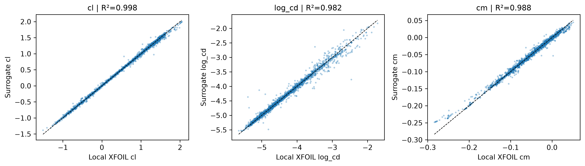
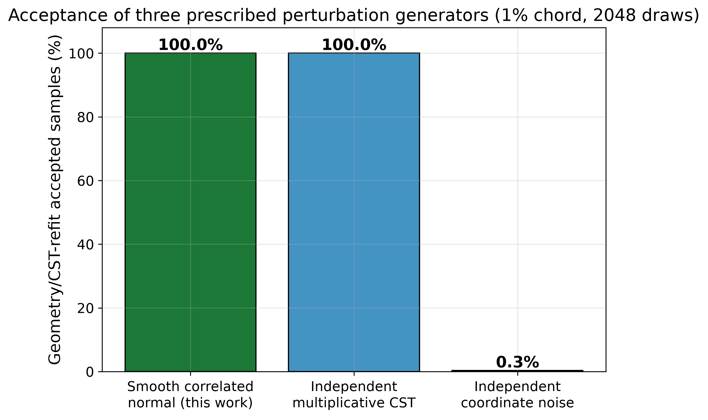
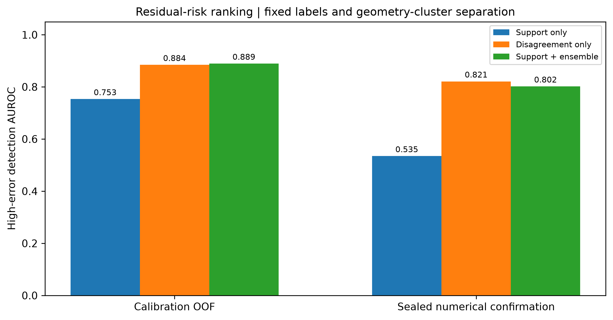
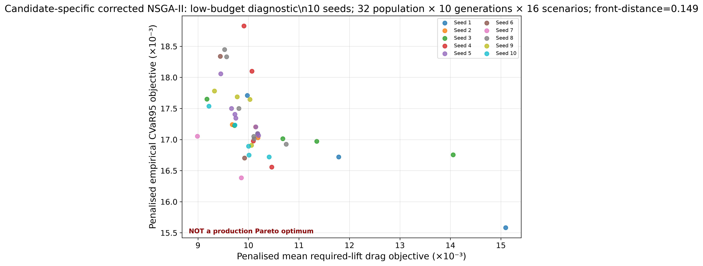
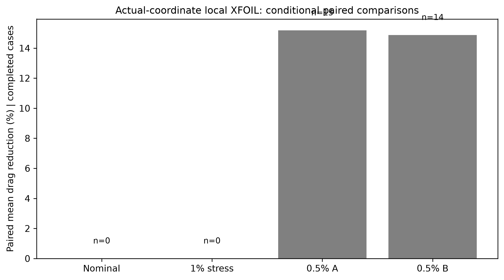
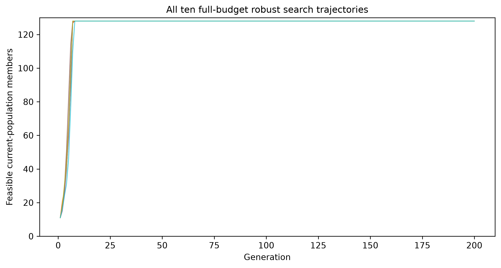
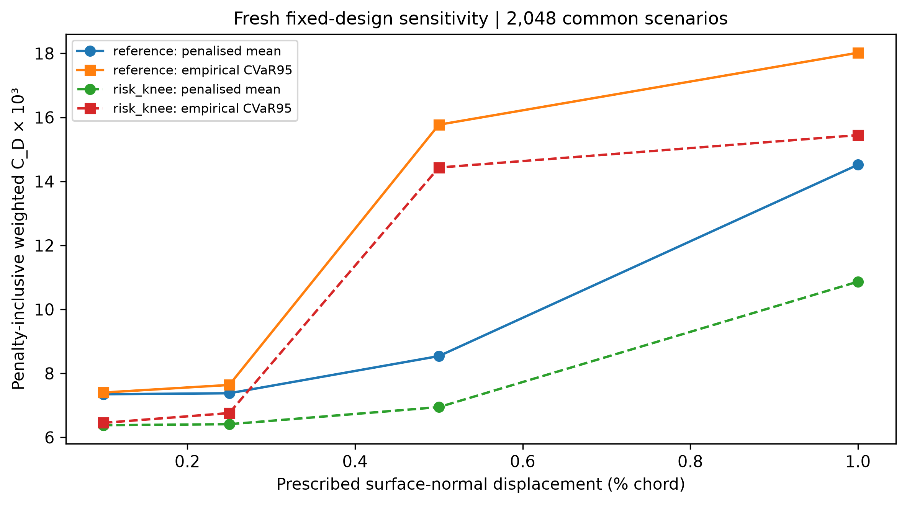
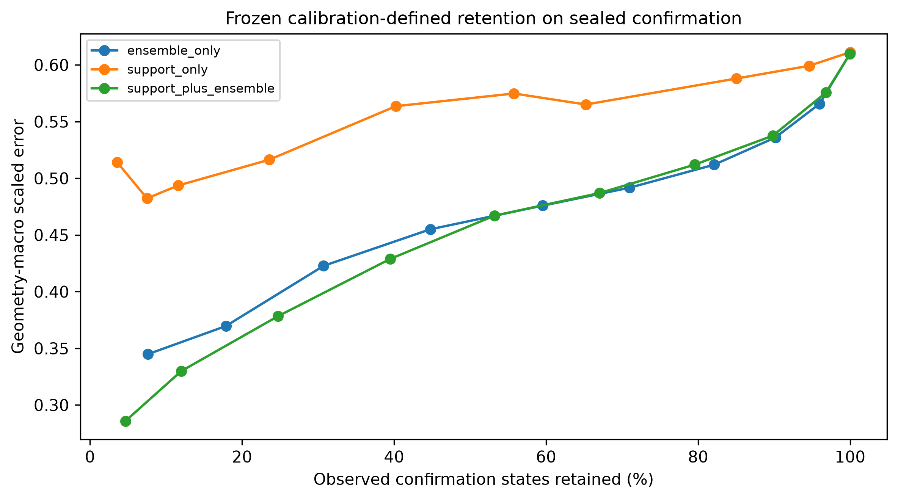

# Data-Driven Aerodynamic Prediction and Robust Aerofoil Selection: A Geometry-Consistent CST and XFOIL Study

## Authors

Benjamin Ian George Gawith; Ava Shahrokhi; Keivan Navaie

## Affiliations

Benjamin Ian George Gawith: School of Engineering, Liverpool John Moores University, Liverpool, UK. Ava Shahrokhi: Department of Maritime and Mechanical Engineering, Liverpool John Moores University, Liverpool, UK. Keivan Navaie: School of Computing and Communications, Lancaster University, Lancaster, UK.

## Corresponding Author

Ava Shahrokhi, A.Shahrokhi@ljmu.ac.uk

## Key Words

Aerodynamic prediction; Class–Shape Transformation; aerofoil optimisation; deep learning; surrogate modelling; numerical uncertainty; multi-objective design

## Highlights

- We resolve a geometry–polar mismatch before fitting and comparing aerodynamic surrogates.
- We train five neural models using 106,931 new XFOIL observations on precisely matched CST coordinates.
- We evaluate prediction and empirical reliability on both protected historical geometries and 200 prospectively sealed numerical test shapes.
- We complete ten independent robust and ten constrained nominal optimisation runs without reducing the declared search budgets.
- We retain all 819 strict selected-design solver attempts, including the 529 cases without usable aerodynamic comparisons.

## Abstract

We investigate the numerical credibility of a neural surrogate used for robust aerofoil selection, focusing on whether geometric inputs match their aerodynamic labels and whether the model remains reliable after design optimisation. An audit identified a coordinate-order defect affecting 1,001 of 1,560 original encodings. We therefore calculate new XFOIL labels on the exact twelve-parameter Class–Shape Transformation (CST) geometries supplied to the surrogate, admitting 106,931 of 141,928 requested states without imputing failures. Five neural ensemble members are trained using development-only stopping and separate calibration. On 15,179 numerical test states, the ensemble achieves R² values of 0.9978, 0.9818 and 0.9882 for lift, logarithmic drag and moment. A 200-geometry confirmation cohort was selected before training and predicted before its XFOIL labels were generated. On 17,968 observed states, support-plus-disagreement high-error ranking AUROC reaches 0.802, while disagreement alone reaches 0.821. A separately generated 40-section NACA-style challenge admits 4,331 of 4,520 numerical states. A direct comparison with NeuralFoil finds lower errors for NeuralFoil, ruling out a claim of superior general-purpose prediction. Nevertheless, the corrected ten-seed NSGA-II study (128 individuals, 200 generations and 64 common perturbation scenarios) meets both predefined numerical front-agreement criteria. Only 290 of 819 strict selected-design XFOIL checks are usable, and no complete nominal matched pair survives. Our contribution is a reproducible, failure-aware numerical methodology rather than a newly superior aerodynamic predictor or demonstrated physical design. Independent CFD remains necessary for the final engineering conclusion.

## Nomenclature

| Symbol | Definition | Units |
|---|---|---|
| α | Angle of attack in the solver coordinate frame | degrees |
| C_L, C_D, C_M | Lift, drag and pitching-moment coefficients | dimensionless |
| x, y_u, y_l | Chordwise coordinate and upper/lower surface ordinates | chord fractions |
| A_u,i, A_l,i | Fourth-degree CST upper/lower Bernstein weights | dimensionless |
| Re, M, Ncrit | Reynolds number, Mach number and XFOIL transition parameter | dimensionless |
| ε | Prescribed maximum surface-normal displacement scale | chord fraction |
| J | Weighted drag at three required lift targets | dimensionless |
| CVaR95 | Mean of the upper 5% of the penalised sample objective | objective units |
| d_s | Standardised nearest-development support distance | dimensionless |
| OOB | Out-of-bag development geometry validation | — |

## 1. Introduction

The design and optimisation of aerodynamic surfaces depend on an accurate account of how geometry influences aerodynamic forces. Even for a two-dimensional aerofoil, evaluating a large number of shapes across incidence and operating conditions requires repeated flow calculations. Wind-tunnel tests and high-fidelity computational fluid dynamics (CFD) provide valuable evidence, but their cost makes exhaustive shape exploration difficult in the early stages of design. Established viscous–inviscid methods provide a less expensive numerical alternative [1,10]. Standard treatments of aerofoil forces, geometry and operating conditions remain important when translating the resulting coefficients into engineering decisions [25,26].

Machine learning offers a further reduction in the cost of repeatedly evaluating a learned aerodynamic response. Reviews by Brunton and colleagues and by Li and colleagues describe the use of learned models to represent fluid-flow quantities, improve numerical workflows and accelerate aerodynamic shape optimisation [2,3,5]. Li, Bouhlel and Martins demonstrated fast data-based aerofoil analysis and design using a surrogate constructed from Reynolds-averaged Navier–Stokes (RANS) calculations [4]. Earlier work by Shahrokhi and Jahangirian also coupled evolutionary airfoil optimisation to surrogate models and CFD [6,7]. These studies establish an important distinction for the present work: using a surrogate within an optimiser is not, by itself, a new aerodynamic design method, nor does a small prediction error guarantee that the selected shape will perform well.

We previously investigated predicting complete aerofoil lift curves using a compact geometry encoding and a neural network. The submitted manuscript used twelve CST parameters to represent a section and considered heterogeneous public XFOIL-labelled polar data. That work motivated the present study but cannot serve as unchanged evidence for it. During independent reproduction, we found that the coordinate ordering of two-block aerofoil files had been misinterpreted in many cases. Once corrected, 1,001 of the 1,560 previously encoded shapes changed. Moreover, fresh solver comparisons showed that a normalised or resampled version of an aerofoil could produce a different numerical polar at the same recorded incidence. A model fitted against the earlier labels could therefore be accurately predicting an inconsistent geometry–coefficient relationship.

These observations led us to reformulate the numerical experiment before drawing conclusions about robust design. We retain the archived dataset and its earlier model outputs for traceability, but generate a new controlled corpus in which every aerodynamic label is calculated on the exact CST reconstruction given to the model. The new surrogate predicts lift, drag and moment at individual incidences, allowing fixed required-lift objectives to be evaluated in optimisation. We then distinguish three questions that are often grouped together: how well the model predicts the numerical solver on existing geometries; whether a confidence or residual-risk screen identifies difficult predictions on independently labelled shapes; and whether optimisation outcomes remain consistent when the selected geometry is subject to prescribed shape perturbations.

The contributions of this paper are the following:

1. We give a source-bound reconstruction of the geometry and aerodynamic data and demonstrate why a coordinate-consistent input–label pairing is necessary before evaluating a surrogate.
2. We train and evaluate a five-member point-conditioned neural ensemble using new XFOIL labels, with geometry-cluster separation, development-only early stopping and calibration held apart from the protected historical test.
3. We assess empirical reliability using both support and ensemble disagreement, including 200 geometry-only selected confirmation shapes whose predictions were fixed before new numerical labels were generated.
4. We implement candidate-specific geometric deviations and compare an unreduced, ten-seed mean–CVaR95 optimisation study with a separately seeded, constrained nominal-only control.
5. We test fixed selected designs using fresh, strict XFOIL calculations and report incomplete polars, failed required-lift intersections and all other adverse cases alongside the successfully evaluated pairs.

Together, these elements provide a reproducible numerical test of whether a surrogate can be used responsibly in early-stage aerofoil selection. We do not claim that CST, deep ensembles, multi-objective genetic algorithms or uncertainty-aware airfoil design are themselves new; those foundations are well established [8,9,13–16,27,29]. The contribution is their checked integration around a correct geometry–label relationship and the separation of predictive, algorithmic and physical validation. In particular, a repeated calculation using XFOIL cannot replace independent viscous CFD or experimental evidence.

## 2. Aerofoil representation and numerical dataset

### 2.1 Class–Shape Transformation

The representation must be sufficiently compact for efficient learning while preserving the geometric variations relevant to section aerodynamics. We use the Class–Shape Transformation developed by Kulfan and Bussoletti [8,9]. Let x denote the chordwise coordinate, normalised such that the leading and trailing edges correspond to x = 0 and x = 1. Both surfaces are represented by a shared class function and a Bernstein polynomial shape function. In the implemented fourth-degree representation,

C(x) = x^(1/2) (1 − x), and B_i(x) = binomial(4,i) x^i (1 − x)^(4−i), i = 0,…,4.

The ten primary coefficients consist of five lower-surface weights and five upper-surface weights. A common leading-edge modifier is defined using L(x) = C(x) exp(−20x), and the final parameter specifies nonnegative trailing-edge thickness. The actual implemented reconstructions are

y_u(x) = C(x) sum_i[A_u,i B_i(x)] + A_LE L(x) + (t_TE/2)x,

y_l(x) = C(x) sum_i[A_l,i B_i(x)] − A_LE L(x) − (t_TE/2)x.

These expressions specify the actual twelve-component feature vector. In particular, the leading-edge modifier is not interchangeable with an additional standard Bernstein coefficient. We fit the source coordinates using least squares, and if an unconstrained fit produces a negative trailing-edge thickness we resolve the remaining coefficients with t_TE fixed to zero. Reconstructed upper and lower surfaces are checked for surface crossing, physical area and maximum fitting error. We use common cosine-spaced surface coordinates when evaluating both the nominal section and perturbed geometries.

The CST fit is still an approximation to the originally downloaded coordinates. This distinction matters when assigning aerodynamic targets. A coefficient generated on an unmodified source contour should not automatically be attributed to a rotated, resampled or fitted contour. We therefore generate the controlled aerodynamic labels on the saved CST geometry itself. Figure 2 summarises the numerical observation coverage arising after this definition is enforced.

### 2.2 Audit of the original sources

The inherited archive contained 1,560 recorded aerofoils and 179,780 numerical states, with source contours originally attributed to the University of Illinois Urbana–Champaign (UIUC) Airfoil Data Site and aerodynamic polars to Airfoil Tools [11,12]. These are provenance statements about the historical files, not a claim that the public websites were used to regenerate the final controlled labels. The original coordinates included multiple conventions, notably two-block Lednicer-style and trailing-edge-to-trailing-edge Selig-style ordering. A reader that assumes the wrong order can produce two smooth-looking but physically different surfaces; an error of this kind may not be obvious from a well-fitted low-dimensional feature vector.

Our audit reinterpreted the coordinate ordering and refitted all available shapes. The result changed 1,001 of the 1,560 original feature vectors, and the subsequent physical admission stage retained 1,256 candidate reconstructions. We also compared selected archived labels against fresh local solver calculations on the original and normalised coordinates. For the AG35 section, the raw-coordinate and archived lift coefficients had an RMS difference of about 0.00127 on the six matched incidence points, whereas the corresponding normalised-coordinate comparison differed by about 0.173. This is an illustrative frame check, not a statistical estimate across the full dataset. It demonstrates why a geometry parser repair alone cannot certify the physical interpretation of the original labels.

Rather than applying an uncertain analytical correction to the archived coefficients, we retain that corpus as a separate historical lineage and construct the new one from fresh numerical observations. The historical results are never reclassified as prospective tests of the rebuilt model.

### 2.3 Exact-coordinate aerodynamic labels

For each of the 1,256 admitted CST shapes, we run the local XFOIL 6.99 executable at Re = 1,000,000, M = 0 and Ncrit = 9. We request two directed incidence sweeps, from 0° to 16° and from 0° to −12°, both at 0.25° steps, with a fixed 200-iteration solver limit and bounded execution time. The union contains 113 distinct incidences per section and a total of 141,928 requested states.

Only actual printed coefficients from clean, zero-exit, non-timeout runs enter the supervised dataset. Each admitted row must have finite lift, drag and pitching moment, with strictly positive drag. Consistent duplicate observations at zero incidence are merged once; conflicting observations and missing values are not used. A case that returns only part of a polar contributes the genuinely observed points, but is not described as a complete sweep. This policy preserves both model reproducibility and information about the solver's convergence selection.

**Table 1. Controlled aerodynamic observations and protected geometry partitions.**

| Partition | Aerofoils with observations | Geometry clusters | Admissible states |
|---|---:|---:|---:|
| Development | 858 | 850 | 74,946 |
| Calibration | 191 | 189 | 16,806 |
| Protected historical test | 175 | 173 | 15,179 |
| Total observed | 1,224 | 1,212 | 106,931 |
| All requested states | 1,256 geometries | — | 141,928 |

The controlled runs provide 106,931 usable states; 34,997 of those requested are missing or fail admission. Only 44 of the 1,256 sections have a complete 113-point polar. Consequently, prediction accuracy calculated on the available rows is conditional on numerical convergence and cannot be extrapolated to regimes for which the solver failed. This limitation becomes particularly important when subsequent design selection asks the surrogate to explore unfamiliar geometries.

### 2.4 Geometry partitions and data independence

We separate data by geometry identity rather than selecting individual incidence points at random. Near-duplicate reconstructed contours are clustered with a fixed RMS geometry tolerance of 10^(−4) chord. Where a reconstructed cluster overlaps an older identity, the most protected partition designation is inherited: protected historical test first, calibration second, development last. This prevents a corrected or aliased contour appearing in training when an earlier form of that same shape was assigned to the protected test.

The resulting development, calibration and protected partitions are shown in Table 1. Their assignment is fixed before numerical labels are used for training. These are meaningful protections against repeated-shape leakage, although the historical section identities had already been examined during the preceding audit; the final test is therefore a protected retrospective test rather than a pristine, newly acquired external population.

### 2.5 Operating mission and aerodynamic constraints

We specify one subsonic numerical mission rather than optimising over unrelated operating conditions. The surrogate input contains twelve CST coefficients plus incidence α in degrees. The output comprises the dimensionless lift coefficient C_L, the natural logarithm of positive drag C_D, and the pitching-moment coefficient C_M. The three target lift coefficients are 0.4, 0.7 and 1.0, with respective weights 0.25, 0.50 and 0.25. Drag at a required lift is found by interpolation only where exactly one admissible crossing lies on the initial rising branch of the polar over the declared service range 0°–8°. We do not extrapolate beyond the service range or treat a later post-stall rise as a second valid design condition.

For a candidate with all three required lift roots, its nominal objective is the weighted coefficient J = 0.25 C_D(C_L = 0.4) + 0.50 C_D(C_L = 0.7) + 0.25 C_D(C_L = 1.0). Missing or ambiguous roots make the candidate infeasible under this fixed mission. Thickness, section area, leading-edge radius and pitching moment also remain subject to engineering constraints relative to the reference shape. Thus, a reduced drag coefficient is not by itself a valid aerodynamic optimisation result.

**Table 2. Reproducible geometry and aerodynamic design definitions.**

| Property | Prescribed value | Interpretation |
|---|---|---|
| CST geometry | Five lower + five upper weights, leading-edge modifier, trailing-edge thickness | Twelve design features |
| Surrogate incidence input | Angle of attack in degrees | Thirteenth neural input |
| XFOIL labels | Re = 10⁶; M = 0; Ncrit = 9 | One numerical operating domain |
| Required lift | 0.4, 0.7 and 1.0 | Unique initial-rising-branch roots |
| Mission weighting | 0.25, 0.50 and 0.25 | Nominal weighted drag coefficient |
| Service incidence interval | 0°–8° | Fine numerical grid at 0.25° |
| Robust objectives | Mean J and empirical CVaR95(J) | Failure-penalised sampled quantities |

## 3. Data-driven aerodynamic model and empirical reliability

### 3.1 Point-conditioned neural surrogate

We formulate aerodynamic prediction as a function of shape and operating incidence, rather than forcing every section onto a fixed-length, fully imputed lift curve. For each observed numerical state, the input is the twelve-component CST vector followed by the recorded angle of attack. The output is a three-component prediction of C_L, log(C_D) and C_M. Predicting the logarithm of positive drag is useful because drag can vary over a wider relative range than lift or moment, particularly across the observed incidence domain. Exponentiating the predicted logarithmic drag gives the coefficient used for design evaluation.

Five neural members share an identical point-conditioned architecture. Each has a 13-input projection, a hidden width of 512, two residual blocks and three output heads. The fixed configuration uses rectified linear units, dropout of approximately 0.122 and about 1.06 million trainable parameters per member. The selected model uses the AdamW optimiser and PyTorch [18–20]. The inherited architecture and its development-only hyperparameter-selection record, including Optuna [21], are preserved; we do not repeat architecture search using the new calibration or protected test labels. This distinction is important because a favourable result after searching the protected test would no longer be an independent assessment of that selected architecture.

Each member draws a distinct geometry-level bootstrap sample from the development partition, with its own random seed. Scaling is fitted to the corresponding training data, and an out-of-bag set of development geometry clusters supplies the stopping criterion. We train for at most 300 epochs with patience of 25 epochs, saving the best development validation checkpoint. The five completed runs used 169, 100, 300, 264 and 182 epochs, with development-selected best epochs of 144, 75, 284, 239 and 157. The calibration and protected historical test data do not select those stopping epochs. Input/target masks prevent unavailable numerical labels being treated as measured zero values, and geometry-balanced sampling avoids making the longest numerical polar the only determinant of training weight.

The ensemble mean supplies the coefficient prediction. We use the between-member variation as one empirical indication of prediction instability rather than as a direct probability distribution over true aerodynamic forces. Deep-ensemble disagreement is a recognised uncertainty heuristic [16]; five predictors trained on overlapping data can share systematic errors and cannot independently establish calibrated uncertainty.

For context, we also fit fixed ridge-regression, histogram-based gradient-boosting and mean-prediction baselines to the same admitted development labels, using scikit-learn [24]. The data processing, array operations and numerical algorithms rely on NumPy and SciPy [22,23]. Baseline results are reported on the same protected numerical states; they are not trained on the protected test to improve their comparison.

### 3.2 Empirical trust domain and residual bands

A low average error does not tell us whether a particular optimised shape is supported by the available development data. We therefore retain an empirical domain screen that considers the standardised nearest-development support distance, the output-specific between-member spread and permitted incidence. Thresholds and residual-band widths are fitted on the separate controlled calibration partition. The screen can accept or reject an individual *predicted numerical state*; it does not certify that an entire section, full polar or optimised geometry is physically valid.

Let the residual of target k on a calibration observation be e_k = y_k − ŷ_k. Output-specific absolute residual quantiles provide descriptive marginal error bands around the corresponding predicted coefficient. We evaluate coverage both at the observation level and after equal weighting of complete observed geometries. These bands are empirical rather than claimed conditional conformal intervals. Ordinary conformal calibration relies on assumptions about exchangeability and data selection [17], and feedback from an optimiser can change the evaluated input distribution [28]. We accordingly avoid presenting accepted-subset or adaptively selected-design coverage as if such a guarantee had been proved.

### 3.3 Geometry-grouped residual-risk assessment

The initial trust rule was designed to decide when numerical predictions should be treated cautiously, but its thresholds do not establish whether ensemble spread adds information beyond geometry support. We therefore carry out a separate, calibration-only error-ranking experiment. Within the calibration geometries, five grouped folds keep reconstructed geometry clusters disjoint between each risk-model training fold and its out-of-fold assessment. The fitted features include standardised support distance, ensemble spread and their combination. Error-scale definitions and upper-decile high-error labels are derived from the calibration training folds alone.

We compare three ridge-ranking models: support alone, disagreement alone and support plus disagreement. The evaluation statistic is the area under the receiver-operating-characteristic curve (AUROC) for ranking the frozen high-error labels. Average precision and equal-geometry weighting are also retained in the evidence. To indicate sampling sensitivity, a geometry-cluster bootstrap is applied to the already fitted out-of-fold scores. This is a descriptive fixed-model interval, not a full repetition of network training, hyperparameter selection and aerodynamic data acquisition.

The operational trust screen is not modified on the basis of the ranking study. It remains possible for the combined model to outperform support alone on calibration data yet perform less well than disagreement alone on a genuinely new set of geometries. We assess that possibility separately rather than selecting a preferred ranking signal after seeing the final design outcomes.

### 3.4 Sealed geometry confirmation before new solver labels

We construct a second numerical test in order to evaluate the frozen predictor on geometries that were not used to train, stop or calibrate its aerodynamic response. Before the controlled model is trained, 200 new CST parameter vectors are generated by fixed-seed convex mixtures of two different development shapes. All are screened for geometric validity and separation from the historical and already selected geometries; their exact vectors and file hashes are sealed. Selection uses only source geometry, not future XFOIL coefficients.

Following ensemble training and calibration-only risk fitting, we evaluate the 200 shapes at the full 113-point incidence grid. The predictions, empirical screen decisions, residual-risk scores and fitted thresholds are written and hash-frozen *before* any of the corresponding confirmation XFOIL runs. We then run the original prescribed solver protocol on the exact sealed coordinates, retain every failure or missing incidence, and join observations to predictions using both geometry identity and incidence. This ordering limits direct selection and fitting leakage for the confirmation outcomes.

This cohort should not be mistaken for a new distribution of unrelated aerofoil families. Its members are convex mixtures of development geometries and may remain statistically dependent on their source parents. Moreover, XFOIL generates both training and confirmation labels. The experiment tests prospective generalisation of the fixed numerical predictor on deliberately held-back geometries, not independent CFD or physical aerodynamic truth.

## 4. Uncertainty-aware aerodynamic optimisation

### 4.1 Definition of prescribed geometric variation

Manufactured sections differ from a nominal design through finite geometric deviations. The nature of those deviations depends on material, process, tolerances and inspection data; none of those manufacturing measurements is available for the present study. Instead, we use a controlled sensitivity model to test the behaviour of the surrogate and optimisation procedure under plausible *mathematical* changes to the surface. We do not assign measured manufacturing probabilities to the resulting scenarios.

The perturbation field is applied in the local surface-normal direction at 201 cosine-spaced points on each actual candidate surface. Eight controls per surface are sampled using scrambled Sobol sequences, interpolated with a finite chordwise correlation length of 0.15 chord, and tapered at the leading edge while displacement is set to zero at the trailing edge. The declared upper/lower latent correlation is zero, although within-surface deviations remain spatially correlated through the interpolation. Nominal amplitudes of 0.1%, 0.25%, 0.5% and 1% chord are used as sensitivity levels. The numerical generator, scrambling seeds, amplitude definitions and refit tolerances are retained with the evidence archive.

A previous implementation used a reference-shape increment when evaluating a different candidate. That operation would have assessed a displacement of the reference instead of the candidate's own geometry. The corrected procedure reconstructs *each candidate's* upper and lower surfaces, applies the spatially correlated normal displacement to those coordinates, verifies that the perturbed surfaces remain valid, fits the displaced shape back to the twelve-parameter CST representation and verifies the refit accuracy before passing it to the surrogate. A refit tolerance of 0.005 chord was selected through earlier numerical sensitivity checks and fixed before the production search; it is not represented as a measured manufacturing allowance.

### 4.2 Aerodynamic objectives and failed scenarios

For each valid perturbed candidate, we compute a polar over the prescribed service domain and extract drag only where all three required lift values have unique crossings on the initial rising branch. The nominal weighted coefficient J is defined in Section 2.5. The robust sample objective includes explicit penalties for invalid displaced geometry, unacceptable CST refits, unavailable required-lift roots or an empirical trust-domain violation. These penalties make the search finite and failure-aware, but the resulting numerical objective can no longer be interpreted everywhere as the physical drag coefficient of a solvable aerofoil.

We optimise two quantities: the arithmetic mean of the finite, penalty-inclusive sample objectives and their empirical 95% conditional value-at-risk. CVaR is used here as the upper-tail mean of a *defined numerical loss*, following the risk-measure framework of Rockafellar and Uryasev [15]. For a finite set of sample losses, the upper five-percent tail consists of the largest losses under the empirical distribution. This choice exposes the cost of poor sampled outcomes, but because the scenarios follow a prescribed mathematical field rather than a measured manufacturing distribution, the tail mean is not a certified probability of a real-world manufacturing failure.

The geometry constraints also remain enforced during optimisation. Relative to the reference section, the permitted thickness ratio is 0.98–1.02, the minimum section area ratio is 0.98, and the leading-edge radius proxy must be at least 0.80 of the reference value. The lower pitching-moment allowance is fixed by the declared reference-relative constraint. We do not change these restrictions retrospectively to obtain a feasible or favourable design. A candidate must satisfy the actual implemented nominal constraints in addition to the risk-aware objectives.

### 4.3 Independent seeded NSGA-II study

We solve the two-objective problem using the NSGA-II method of Deb and colleagues [13], implemented through pymoo [14]. The production budget is fixed at 128 individuals, 200 generations, 64 common uncertainty samples and ten independent algorithm seeds. All ten seeds are included whether or not their returned fronts are favourable. Each generation is checkpointed, and its population size, objective values, feasibility counts, numerical invalidity and evaluation history are retained in reproducible receipts.

We evaluate algorithm agreement using the original numerical criterion: at least eight of ten seeds must yield feasible solutions and the mean pairwise normalised distance between feasible seeded fronts must not exceed 0.20. A limitation of the earlier reporting method was that the objective normalisation used the ranges of the solutions found *after* the optimisation. We retain that pooled-range calculation as a historical diagnostic and separately report a reference-scaled distance whose positive scales are fixed before the search. Reporting both avoids retrospectively changing the scale to secure a pass.

An algorithmically stable front is not proof of a global Pareto optimum. In particular, the model itself is approximate, the scenario set is finite, the empirical screen rejects some numerical states and the physical manufacturing distribution is unknown. We therefore limit the optimisation claims to the actual candidate, solver and algorithm budgets that have been executed.

### 4.4 Matched constrained nominal control

To establish a meaningful comparison, we run a separate nominal-only search with ten distinct seeds, again using 128 individuals and 200 generations. The control optimises the nominal weighted drag J while preserving the same reference, geometry bounds, nominal incidence domain, moment restrictions and empirical screen. The nominal procedure does not incur 64 perturbed evaluations for every candidate, so the two studies have matched *evolutionary budgets* rather than identical total neural inference cost.

The final robust and nominal populations are evaluated and retained using their own frozen objectives and constraints. A deterministic geometry tie-break is used when selecting from equal-score feasible candidates. The risk-knee design is chosen from the pooled feasible non-dominated robust front by its fixed reference-scaled distance to the feasible ideal. The nominal control minimises nominal weighted drag across all feasible final nominal populations. Minimum-mean and minimum-tail candidates are retained as additional diagnostics. No fresh selected-design XFOIL result is used to choose these finalists.

### 4.5 Fresh scenarios and strict selected-design verification

After fixed finalist selection, we evaluate the chosen geometries under newly scrambled sets of 2,048 latent perturbations at each of four prescribed amplitudes. These scenarios are distinct from the 64 common samples that formed the optimisation objectives. We record their penalty-inclusive mean and CVaR95, along with invalid geometry, fit and lift-root cases. They are a numerical sensitivity test of fixed models and designs, not a Monte Carlo validation of real manufacturing deviations.

We also run fresh local XFOIL directly on saved coordinates for the reference, nominal control and risk-knee sections, including perturbed surfaces. The strict verification request uses 45 incidence points from 0° to 11° in 0.25° steps, preceded by a warm-up sequence, with 200 solver iterations and a bounded runtime. A case is usable only when every required point is present from a clean run, all coefficients are finite with positive drag, and the three lift targets have unique admissible roots in 0°–8°. The inability to evaluate one or more roots is recorded as a failure, not assigned a nominal drag value. All 819 scheduled cases must be accounted for and the paired comparison is computed only when the reference and candidate are *both* usable under the same sampled perturbation.

This verification is purposely stricter than accepting whichever points happen to converge. It tests the selected design's numerical evidence quality as well as its apparent aerodynamic performance. However, it uses the same family of viscous–inviscid numerical method as the training data and is not an independent RANS CFD or experimental check. We reserve that separate physical-model validation for Section 7.

## 5. Results and numerical assessment

### 5.1 Controlled aerodynamic prediction

The controlled source-to-label audit yields 106,931 valid XFOIL states from 1,224 reconstructed sections. Of these, 74,946 development observations are assigned to 858 aerofoils, 16,806 calibration observations to 191 aerofoils, and 15,179 protected historical test observations to 175 aerofoils. The remaining requested solver states are absent or ineligible and are not included in the numerical error denominator. The model freeze, feature scalers and calibration rule are bound to their exact source and data identities.

Table 3 compares the neural ensemble with two simple baselines on the common protected numerical test. We compute the usual coefficient of determination R² and mean absolute error (MAE) on observed states, and also report a geometry-macro MAE that gives each evaluated shape equal importance. For drag, the model is trained on log(C_D); we additionally reconstruct C_D in linear units to show the effect of the logarithmic transformation.

**Table 3. Prediction accuracy on the 15,179 observed numerical states in the protected historical test.**

| Target | Ensemble R² | Ensemble MAE | Geometry-macro MAE | Ridge R² | Gradient-boosting R² |
|---|---:|---:|---:|---:|---:|
| C_L | 0.9978 | 0.02205 | 0.02185 | 0.9656 | 0.9933 |
| log(C_D) | 0.9818 | 0.04737 | 0.05123 | 0.1628 | 0.9518 |
| C_M | 0.9882 | 0.00331 | 0.00320 | 0.8966 | 0.9587 |
| C_D (linear) | 0.9444 | 0.00132 | 0.00135 | — | — |

The ensemble provides low observed-state errors for this specific numerical data distribution. In particular, the lift and moment R² values are high, although the linear drag R² of 0.9444 is lower than the logarithmic drag R² of 0.9818. Figure 1 compares predicted and actual coefficients without interpreting the sampled pointwise agreement as independent experimental validation.

The result must not be presented as a percentage improvement over the model trained on the original archived polars. The new experiment changes both the admitted geometries and the precise coordinate–label relationship. It is more internally consistent, but its test set is not an identical aerodynamic benchmark. Moreover, solver convergence determines which states are available to score; extrapolation to the 34,997 missing controlled states remains unmeasured.

### 5.2 Empirical reliability and numerical confirmation

The calibration-derived empirical screen accepts 9,913 of the 15,179 observed test states and rejects 5,266. Its observed-state residual-band coverage is 96.8% for C_L, 95.9% for log(C_D), and 97.7% for C_M when all admissible test states are counted. These are measured marginal coverage fractions for fixed observed numerical labels. They do not establish conditional prediction coverage for every accepted state, a simultaneous band over an entire polar, or a coverage guarantee for a shape selected by the optimiser.

The separate geometry-cluster out-of-fold study provides a more direct test of whether the risk features identify high-error cases. On the calibration data, the support-only classifier has AUROC 0.753, while support combined with ensemble disagreement reaches 0.889. An ensemble-disagreement-only classifier reaches 0.884. The combined-minus-support increment is 0.136, with a fixed out-of-fold geometry-bootstrap 95% interval of approximately [0.091, 0.200]. This interval conditions on the fitted out-of-fold scores; it does not include uncertainty from retraining all neural models.

We then check the frozen scores against newly computed labels for the 200 sealed confirmation shapes. XFOIL supplies 17,968 of 22,600 requested states. The remaining 4,632 states lack admissible solver truth. On the observed subset, the combined risk model has AUROC 0.802, compared with 0.535 for support distance alone. The difference is 0.267, with a fixed-model geometry-bootstrap interval of approximately [0.200, 0.340]. Crucially, the disagreement-only score achieves AUROC 0.821 on this same cohort, which is *higher* than the combined score. We therefore do not claim that the combined score is the best available detector of numerical error.

**Table 4. Calibration-only risk ranking and prospective numerical confirmation.**

| Endpoint | Support-only score | Support + disagreement | Interpretation |
|---|---:|---:|---|
| Calibration-cluster OOF high-error AUROC | 0.753 | 0.889 | Combined increment 0.136 |
| Calibration disagreement-only AUROC | — | 0.884 | Almost equals combined score |
| Sealed 200-geometry confirmation AUROC | 0.535 | 0.802 | Combined increment 0.267 |
| Sealed confirmation disagreement-only AUROC | — | 0.821 | Higher than combined score |
| Confirmed solver observations | — | — | 17,968 / 22,600 requested |
| Empirical screen accepted on observed confirmation | — | — | 11,718 / 17,968 observed |

Table 4 and Figure 3 separate the retrospective calibration-fold ranking from the sealed prelabel confirmation. The latter is more relevant to the frozen ranking features, but it remains a controlled interpolation-style numerical experiment on mixtures of known source geometry. Because failures of the solver do not provide truth for the missing states, no AUROC, MAE or band coverage can be assigned to those states without further independent measurements. The screen is therefore left in its previously frozen operational form rather than retuned to the favourable confirmation subset.

### 5.2.1 Post hoc benchmark against an established aerodynamic surrogate

To establish what additional predictive value the new model offers, we compared it with NeuralFoil [29], rather than assuming that a five-member ensemble is more accurate than an established physics-informed predictor. NeuralFoil 0.3.3 (xlarge) was run through AeroSandbox 4.2.10 on the *same exact CST-derived coordinates*, refitted to NeuralFoil's native Kulfan parameterisation. The common numerical conditions were Re = 10⁶ and Ncrit = 9. Neither trained model was updated. The full sealed-confirmation comparison includes all 200 requested geometry identities and all 22,600 original incidence requests; numerical error can be measured only for the 17,968 clean XFOIL-observed states.

On those common observed states, our model's MAE for C_L, C_D and C_M is 0.020610, 0.001146 and 0.003019, respectively, while NeuralFoil's is 0.009355, 0.000937 and 0.001465. NeuralFoil therefore gives lower errors on all three coefficients in this comparison. A fixed-model bootstrap resampling entire confirmed geometries places the geometry-macro error differences (NeuralFoil minus ours) below zero for each output. On the originally sealed numerical states *without* clean XFOIL observations, NeuralFoil's negative analysis-confidence score achieves AUROC 0.8874 for ranking numerical unavailability; our frozen ensemble-only and support-plus-ensemble risk scores achieve 0.7351 and 0.7164. Missingness is an XFOIL execution outcome, not physical CFD error or manufacturing failure. The two methods' confidence scores are not mathematically equivalent and cannot be treated as calibrated probabilities. Detailed denominator accounting and uncertainty summaries are in the supplementary numerical comparison.

A further fixed-incidence comparison (2°, 4° and 6°) includes all 1,013 solver-observed states from 357 geometries across the protected historical and sealed cohorts. It independently reproduces NeuralFoil's lower error on both groups. This is a *post hoc competitor diagnostic*, not a predeclared benchmark used to select network architecture. NeuralFoil's own training-geometry overlap is unknown, and the sealed shapes remain mixtures of development geometries, so the result does not establish general blind-family performance for either model.

### 5.2.2 Geometry-distinct numerical source-family challenge

To test more than local mixtures of previously admitted shapes, we separately generated 40 four-digit NACA-style sections from a fixed-seed analytic camber/thickness recipe. Each was reconstructed with the same twelve-component CST features, screened for surface validity and kept at least 0.002 chord RMS away from *all 1,256* earlier controlled input shapes, with a comparable separation between the new sections. The geometry source recipe and all 40 identifiers were frozen before new labels were calculated. Both the existing neural ensemble and the pretrained NeuralFoil were evaluated and their prediction files frozen before XFOIL was run. No new model fitting or calibration selection used these outcomes.

The independent case audit confirms 40 complete geometry receipts and **4,331 genuine admitted XFOIL states from 4,520 requests**, with 189 missing observations. On those genuinely observed states, our ensemble's MAE for C_L, C_D and C_M is 0.019656, 0.000636 and 0.004087; NeuralFoil's corresponding MAEs are 0.017226, 0.000503 and 0.003599. Thus NeuralFoil retains a smaller numerical error, but the gap is narrower than on the sealed mixture cohort. The controlled empirical trust flag accepts 2,248 observed states and rejects 2,083; accepted-state errors are smaller for lift (0.01533 versus 0.02432) and moment (0.00317 versus 0.00507), but *not* drag (0.000711 versus 0.000556). This is a useful, mixed result rather than a universal validation of the trust screen.

The new analytic shapes are *distinct numerical source shapes*, not proof of completely unseen classes in NeuralFoil's internal training. They were devised after examining the earlier study, so the challenge is an explicitly post hoc geometry-separated sensitivity analysis, not an independently preregistered external-family trial. XFOIL remains the source of their aerodynamic labels and cannot replace independent RANS CFD. Full source geometry hashes, predictions-before-labels evidence and 40 solver cases are archived separately, without mixing these labels into the original training, calibration or ten-seed search.

### 5.3 Reproducibility of the robust search

The full robust optimisation budget consists of ten completed independent seeds, each with 200 generations of 128 individuals and 64 candidate-specific uncertainty samples. The completed generation receipts independently reconcile to 2,000 generations and 256,000 candidate evaluations. All ten seeds produce feasible final entries under the declared numerical constraints; 371 feasible final designs are recorded in their reported final solution sets. Neither infeasible intermediate candidates nor failure-penalty contributions are discarded from the generation histories.

The reference geometry has the pre-run mean and empirical-tail objectives of approximately 0.01209 and 0.01638, respectively, under the fixed numerical profile. The mean cross-seed distance after scaling by predeclared reference objectives is 0.0243. The historical pooled-range distance is 0.1029. Both lie below the numerical tolerance of 0.20, and all ten seeds have feasible final solutions, exceeding the minimum eight-seed requirement. Thus, the completed implementation **passes both declared finite-budget agreement diagnostics**. Figure 4 shows the feasible design fronts and Figure 6 shows the actual generation histories, not an idealised convergence curve.

A pass on these metrics establishes repeatability within the specified algorithm, surrogate, service conditions and finite perturbation profile. It is not a proof that the returned point is globally optimal, that the search sampled every manufacturing scenario, or that independent aerodynamic solvers would order the shapes identically. Those are separate questions.

The matched nominal-only control also completes ten independent 128 × 200 searches with the unchanged nominal constraints. All ten control seeds yield feasible results. The minimum recorded feasible nominal weighted drag is approximately 0.00574, compared with the robust study's minimum feasible *penalty-inclusive mean* of approximately 0.00855. These quantities use different objectives and cannot be subtracted to claim the robust optimiser is aerodynamically inferior or superior. The relevant comparison is between the fixed final designs under a common evaluation and, subsequently, an independent solver.

**Table 5. Unreduced robust and matched constrained nominal searches.**

| Property | Robust mean–CVaR95 search | Constrained nominal-only control |
|---|---|---|
| Independent optimisation seeds | 10 | 10 |
| Population and generations per seed | 128 × 200 | 128 × 200 |
| Perturbation states per robust candidate | 64 | No perturbation objective |
| Seeds with feasible final designs | 10 | 10 |
| Full-profile completion | All 2,000 generations | All 2,000 generations |
| Minimum recorded feasible objective | 0.00855 (penalised mean) | 0.00574 (nominal weighted drag) |
| Common design constraints | Geometry, required lift, pitching moment and trust | Same nominal constraints |
| Predeclared front-agreement criterion | Pass under both numerical scales | Not an identical two-objective criterion |

We retain the distinction between the nominal and robust objectives throughout the remaining verification. A numerically feasible optimum is still conditional on the learned model and the chosen lift/drag constraints.

### 5.4 Fresh perturbation sensitivity of fixed designs

After freezing the selected designs, we evaluate fresh sets of 2,048 geometric scenarios at four prescribed amplitudes. The use of new Sobol scrambles reduces the risk of reporting only the perturbations previously used in the optimisation fitness calculation. For the 1% chord sensitivity level, the reference geometry has a penalty-inclusive mean weighted-drag objective of 0.014520 and an empirical CVaR95 of 0.018019. The selected risk-knee geometry has corresponding values of 0.010867 and 0.015445. Figure 7 plots the full amplitude sensitivity rather than relying only on these two cases.

On this particular frozen surrogate and prescribed perturbation field, the risk-knee solution has lower numerical mean and upper-tail objectives at the 1% level. This is a statement about the recorded penalised predictions. Some scenarios have invalid geometry, unacceptable refits, missing roots or predictions beyond the empirical support domain. Their penalties are included in the objective. We do not reinterpret these penalised numbers as measured wind-tunnel drag, the real probability of fabrication failure or a bound on drag for every manufactured part.

### 5.5 Strict selected-design XFOIL verification

We next use the actual displaced coordinates, rather than the surrogate refits, for fresh local XFOIL checks. The predeclared programme contains three nominal cases and three sets of perturbation tests for each of the reference, risk-knee and constrained nominal-control designs. In total, 819 fixed cases are attempted. Only 290 satisfy all complete-polar, process-exit, finite coefficient and required-lift-root conditions; the other 529 are retained as rejected or unavailable cases. The nominal reference, risk-knee and nominal-control runs do not all provide the complete strict polar. Accordingly, **no matched strict nominal drag percentage is estimable**. We do not borrow a favourable nominal value from the historical pre-repair experiment or infer a drag coefficient for any failed case.

For the 0.5% chord scenario set A, fifteen complete reference–risk-knee pairs permit a mean paired reduction in weighted drag of 15.2%. Scenario set B has fourteen such pairs, with a corresponding mean reduction of 14.9%. These percentages are conditional on both members of a pair having a usable strict numerical polar. For comparison, the constrained nominal-only design gives 19.8% and 18.8% mean reductions on its 21 and 22 matched pairs from the two 0.5% sets. We do not select between these designs by excluding cases that failed for one candidate. At the more severe 1% setting there are zero usable matched reference–risk-knee pairs, so no robust-design drag-reduction estimate is defensible there; the nominal-control comparison has only two complete matched pairs and is too sparse to support a population-tail conclusion.

**Table 6. Strict local-XFOIL matched-case comparisons; percentages are conditional on complete reference and candidate polars.**

| Prescribed scenario and selected comparator | Complete matched pairs | Mean paired weighted-drag reduction | Largest reference / candidate drag among paired cases |
|---|---:|---:|---|
| Nominal, risk-knee | 0 | Not estimable | Not estimable |
| Nominal, nominal-only control | 0 | Not estimable | Not estimable |
| 1% chord, risk-knee | 0 | Not estimable | Not estimable |
| 1% chord, nominal-only control | 2 | 15.7% | 0.00880 / 0.00766 |
| 0.5% chord set A, risk-knee | 15 | 15.2% | 0.00860 / 0.00721 |
| 0.5% chord set A, nominal-only control | 21 | 19.8% | 0.00862 / 0.00704 |
| 0.5% chord set B, risk-knee | 14 | 14.9% | 0.00814 / 0.00695 |
| 0.5% chord set B, nominal-only control | 22 | 18.8% | 0.00846 / 0.00745 |

The 819 cases are not a representative sample of all possible physical manufacturing defects. Numerical convergence itself selects the subset on which a paired coefficient can be measured. In particular, it would be misleading to treat the 15 or 14 successful pairs as an unbiased sample of 128 attempted deviations, or to interpret their maxima as a valid CVaR95 estimate for the entire prescribed population. Figure 5 therefore retains both the apparent paired benefits and the unsuccessful observation counts. The independent case-level source audit confirms the complete 819 = 290 + 529 accounting.

A further consequence is that an apparent surrogate-based advantage cannot yet be qualified as a verified physical aerodynamic improvement. The XFOIL family is common to training and verification, and complete strict polars are unavailable for most selected cases. This is not an argument for suppressing the favourable completed-pair reductions; it is a requirement to report their much narrower evidential scope.

### 5.6 Computational and source-evidence integrity

All selected-case solver requests, raw outputs, exit states, timeouts, admitted coefficients and missing incidences are retained together with the exact geometry and executable identities. Training checkpoint hashes, calibration folds, the geometry-only confirmation seal, predictions-before-labels receipt, all robust and nominal seeded histories and the final selected-design freeze are separate records. Independent reconciliation scripts recompute the reported totals and verify that the selected numerical outcomes were not used to choose the candidates. The dataset and raw solver archive remain available as hash-verified files in the review handoff.

Earlier GPU inference benchmarks describe the time required for specific single-state or batched surrogate calculations. They are not the end-to-end running time of the complete robust optimiser, which also performs geometry reconstruction, perturbation, refitting, trust assessment, constraint evaluation and checkpointing. We therefore make no unmeasured claim of a particular full-workflow speedup over CFD or XFOIL. The accepted numerical test suite and frozen source manifests demonstrate software repeatability under the documented environment, not equivalence to an independent physics model.

## 6. Discussion

The controlled experiment starts from the geometry–label relationship rather than treating the size of an archived dataset as a guarantee of physical meaning. We removed the ambiguity caused by conflicting coordinate orders by computing new XFOIL labels on the exact CST reconstructions used as inputs. This does not establish the accuracy of XFOIL relative to independent physics, nor does it mean that a fitted contour is identical to its historical source.

Our high observed-state R² values show that a point-conditioned ensemble can represent the numerical response on the admitted data. Nonetheless, only 44 sections have all 113 requested states, and the missing observations are determined partly by solver convergence. We cannot assume the inaccessible states have the same prediction error as the observations that survived admission. This matters most during optimisation, when unusual shapes can expose inadequately sampled regions of the response.

### 6.1 Empirical reliability and its limits

The calibrated screen and the residual-risk ranking are different measurements. The first is a fixed operational rule for flagging predicted states outside known support; the second asks whether support distance and ensemble spread rank actual numerical errors. On the calibration folds, ensemble disagreement adds information beyond support alone. The sealed confirmation reproduces this basic finding, although disagreement alone achieves a higher AUROC than the combined score in that cohort. Consequently, we do not retrospectively change the operational screen or claim that any ranking model provides guaranteed conditional coverage.

These limitations are consistent with research on deep ensembles [16] and uncertainty quantification under exchangeability and feedback shift [17,28]. Our bootstrap intervals condition on already fitted predictions and solver-observed labels; they do not account for complete network retraining, unrelated geometry distributions, failed numerical solutions or manufacturing variability. We have not implemented or proved a feedback-adaptive conformal guarantee.

### 6.2 Interpretation of the robust design

The ten-seed experiment confirms that the corrected candidate-specific uncertainty mechanism can operate within the fixed service and engineering constraints. Passing the two numerical front-agreement checks is evidence of seeded repeatability, not a global optimisation proof. The numerical mean and CVaR95 mix predicted drag with prescribed failure penalties, and are not everywhere equal to physical aerodynamic coefficients. Without manufacturing measurements we cannot assert that the sampled displacement amplitudes or correlations describe an actual production process.

Recent work on surrogate-assisted airfoil design and uncertainty-aware optimisation [4–7,27,29] also restricts claims of originality. We do not introduce CST, NSGA-II, ensembles or robust design as new concepts. What this study establishes is an executable and independently auditable geometry–label contract, with data admission, model calibration, numerical selection and complete solver failure records kept separate.

The new head-to-head results additionally challenge any interpretation that the five-member network is intrinsically more accurate or safer than existing aerodynamic predictors. NeuralFoil has lower numerical coefficient errors on both the sealed cohort and our 40 geometry-distinct NACA-style sections, and its confidence score ranks numerical XFOIL missingness more accurately on the sealed cohort. These findings narrow our contribution to a *methodology*: geometry–label consistency, genuine prospective separation, failure-aware constraints and reconstructable evidence of what is and is not known. They also show that the framework can be applied to different model classes rather than depending on a claim of one uniquely superior predictor.

### 6.3 Verification failures and scope

Only 290 of the 819 strict local XFOIL cases meet the fixed complete-polar rule. None of the prescribed nominal comparisons yields a complete matched pair. The 0.5% perturbation subsets do have positive paired drag reductions, but their small successful denominators and severe numerical missingness cannot justify an unconditional manufacturing-tail claim. Raising the solver iteration limit or reducing the incidence grid after observing these failures could be useful in a separately labelled exploratory experiment, but would not validate the original predeclared protocol.

The study has five principal limits: a single numerical operating condition, a CST approximation to historical geometry, previously inspected protected identities, confirmation shapes constructed from development geometry mixtures, and prescribed rather than measured manufacturing deviations. Training, confirmation and selected verification also share the same XFOIL numerical model. These limits define the evidence, and make independent CFD necessary before the selected design's physical aerodynamic ranking can be established.

## 7. Independent CFD verification protocol — results pending

### 7.1 Fixed cases and physical modelling

Independent viscous CFD must compare the preselected reference, risk-knee and nominal-control geometries on their actual frozen coordinates. None of the existing XFOIL numerical outcomes is substituted for this work. The final solver study should adopt the same Reynolds and Mach conditions where physically appropriate, with independently declared transition/turbulence treatment. XFOIL Ncrit = 9 is not a RANS turbulence boundary condition.

We will report the exact computational domain, inflow and outflow boundaries, near-wall y⁺ strategy, meshing method, turbulence and transition models, solver discretisation, residual and force-convergence histories, and mesh/domain sensitivity. Equal numerical settings must be applied to the fixed candidates. The reference shape should first be checked against an appropriate independent benchmark where one is available.

### 7.2 Required lift, moments and adverse cases

The central engineering comparison is drag and pitching moment at each of the required lift coefficients 0.4, 0.7 and 1.0. CFD must locate these operating points at matched *achieved lift*, not simply at identical incidence. Force and moment convergence, root feasibility, physical flow features and uncertainties caused by mesh refinement or transition modelling must be retained. Invalid geometry, non-converged cases and adverse ranking reversals will be explicitly reported rather than assigned artificial truth or excluded.

The final CFD evidence should include the unperturbed designs and a declared, source-bound set of matched geometric disturbances. No newly observed CFD result may change the originally sealed design selection. The final comparison should state absolute coefficients and paired differences as well as any claimed percentage improvement. This allows the final judgement to reflect physical-model sensitivity rather than only the nominal result.

### 7.3 Unavailable results

**CFD has not yet been performed.** There are no independent RANS lift, drag or moment coefficients, CFD contour figures, grid-convergence values or validated post-CFD performance percentages to insert. The protocol is complete as a test definition, but the associated numerical outcomes and physical comparison will be added only after actual source-bound cases exist.

## 8. Numerical findings and final conclusion status

We have completed a geometry-consistent numerical study containing 106,931 admissible XFOIL labels, a trained and calibrated five-member ensemble, a protected numerical test, a 200-geometry prelabel-sealed confirmation, ten robust and ten constrained nominal optimisation runs, fresh 2,048-scenario sensitivity calculations and all 819 strict selected solver attempts. The robust algorithm passes both predefined numerical agreement checks. On observed confirmation labels, ensemble disagreement contributes useful information for identifying numerical prediction errors. The selected-design verification, however, rejects the majority of attempted cases and cannot provide a matched nominal percentage.

These results support a reproducible numerical research framework, not a claim that the selected aerofoil is physically superior. We reserve the final aerodynamic design conclusion for the independent CFD results of Section 7. The final conclusion must include adverse solver evidence and may find that no robust design ranking can be established. We will not replace a missing CFD result with a favorable surrogate prediction.

## CRediT authorship contribution statement

The following roles are proposed from the available work record and require explicit confirmation from each coauthor: Benjamin Ian George Gawith — conceptualisation, methodology, software, data curation, formal analysis and original writing; Ava Shahrokhi — supervision, conceptualisation, methodology and review/editing; Keivan Navaie — supervision, methodology and review/editing. These are not presented as already-approved declarations.

## Declaration of competing interest

The authors must verify and approve their individual disclosures before journal submission. A conflict-free declaration is not inferred from unavailable records.

## Declaration of generative AI use

AI-assisted tools were used for software inspection, numerical-evidence reconciliation, source retrieval and manuscript drafting. Numerical claims remain linked to executable results and hashes, and bibliographic claims to checked publications. The named authors remain responsible for interpretation, declarations and submission.

## Funding

Funding status requires confirmation from the authors. No grant award is invented or inferred absent from the available source.

## Data and code availability

The repository preserves the source, fixed study protocol, trained and calibrated model manifests, protected results, confirmation seal, selected-design identities, optimisation histories and numerical evidence ledger. The large XFOIL label/solver records and trained weights are retained as SHA-256 verified local handoff archives separate from historical model versions. Third-party source geometry and polar redistribution must respect its own terms. A locally verified OneDrive handoff does not by itself establish public deposition or cloud synchronisation.

## Figures

**Figure 1.** Observed numerical XFOIL coefficients against held-out ensemble predictions for lift, logarithmic drag and moment. These are not independent CFD data.

**Figure 2.** Requested and admitted exact-coordinate label counts across development, calibration and protected historical test geometries.

**Figure 3.** Calibration out-of-fold and sealed numerical-confirmation high-error AUROC, showing support, disagreement and their combination separately.

**Figure 4.** Actual feasible ten-seed NSGA-II fronts; finite numerical repeatability does not prove global optimality.

**Figure 5.** Strict selected-design matched local-XFOIL comparisons, with conditional paired denominators and solver failures.

**Figure 6.** Generation histories and feasible populations from all ten robust optimisation seeds.

**Figure 7.** Fresh 2,048-scenario penalty-inclusive numerical mean and CVaR95 across prescribed surface-displacement amplitudes.

**Supplementary Figure S1.** Frozen empirical risk-score retention and observed numerical error on the sealed confirmation subset.

## References

[1] Drela, M. & Giles, M. B. (1987). Viscous–inviscid analysis of transonic and low Reynolds number airfoils. AIAA Journal, 25(10), 1347–1355. https://doi.org/10.2514/3.9789

[2] Vinuesa, R. & Brunton, S. L. (2022). Enhancing computational fluid dynamics with machine learning. Nature Computational Science, 2(6), 358–366. https://doi.org/10.1038/s43588-022-00264-7

[3] Brunton, S. L., Noack, B. R. & Koumoutsakos, P. (2020). Machine learning for fluid mechanics. Annual Review of Fluid Mechanics, 52, 477–508. https://doi.org/10.1146/annurev-fluid-010719-060214

[4] Li, J., Bouhlel, M. A. & Martins, J. R. R. A. (2019). Data-based approach for fast airfoil analysis and optimization. AIAA Journal, 57(2), 581–596. https://doi.org/10.2514/1.J057129

[5] Li, J., Du, X. & Martins, J. R. R. A. (2022). Machine learning in aerodynamic shape optimization. Progress in Aerospace Sciences, 134, 100849. https://doi.org/10.1016/j.paerosci.2022.100849

[6] Shahrokhi, A. & Jahangirian, A. (2010). A surrogate assisted evolutionary optimization method with application to the transonic airfoil design. Engineering Optimization, 42(6), 497–515. https://doi.org/10.1080/03052150903305468

[7] Jahangirian, A. & Shahrokhi, A. (2011). Aerodynamic shape optimization using efficient evolutionary algorithms and unstructured CFD solver. Computers & Fluids, 46(1), 270–276. https://doi.org/10.1016/j.compfluid.2011.02.010

[8] Kulfan, B. M. (2008). Universal parametric geometry representation method. Journal of Aircraft, 45(1), 142–158. https://doi.org/10.2514/1.29958

[9] Kulfan, B. M. & Bussoletti, J. E. (2006). "Fundamental" parametric geometry representations for aircraft component shapes. In 11th AIAA/ISSMO Multidisciplinary Analysis and Optimization Conference, AIAA 2006-6948. https://doi.org/10.2514/6.2006-6948

[10] Drela, M. (1989). XFOIL: An analysis and design system for low Reynolds number airfoils. In Low Reynolds Number Aerodynamics, Lecture Notes in Engineering, vol. 54, Springer, 1–12. https://doi.org/10.1007/978-3-642-84010-4_1

[11] Selig, M. S. (n.d.). UIUC Airfoil Data Site. University of Illinois Urbana–Champaign. Accessed 14 October 2026. https://m-selig.ae.illinois.edu/ads/coord_database.html

[12] Airfoil Tools (n.d.). Airfoil Tools: numerical aerofoil polar database. Historical source of archived polars. Accessed 21 October 2026. https://www.airfoiltools.com/

[13] Deb, K., Pratap, A., Agarwal, S. & Meyarivan, T. (2002). A fast and elitist multiobjective genetic algorithm: NSGA-II. IEEE Transactions on Evolutionary Computation, 6(2), 182–197. https://doi.org/10.1109/4235.996017

[14] Blank, J. & Deb, K. (2020). pymoo: Multi-objective optimization in Python. IEEE Access, 8, 89497–89509. https://doi.org/10.1109/ACCESS.2020.2990567

[15] Rockafellar, R. T. & Uryasev, S. (2000). Optimization of conditional value-at-risk. Journal of Risk, 2(3), 21–41. https://doi.org/10.21314/JOR.2000.038

[16] Lakshminarayanan, B., Pritzel, A. & Blundell, C. (2017). Simple and scalable predictive uncertainty estimation using deep ensembles. In Advances in Neural Information Processing Systems 30 (NIPS 2017), 6402–6413. https://papers.neurips.cc/paper_files/paper/2017/hash/9ef2ed4b7fd2c810847ffa5fa85bce38-Abstract.html

[17] Angelopoulos, A. N. & Bates, S. (2021). A gentle introduction to conformal prediction and distribution-free uncertainty quantification. arXiv:2107.07511. https://arxiv.org/abs/2107.07511

[18] Loshchilov, I. & Hutter, F. (2019). Decoupled weight decay regularization. In International Conference on Learning Representations (ICLR 2019). arXiv:1711.05101. https://arxiv.org/abs/1711.05101

[19] Nair, V. & Hinton, G. E. (2010). Rectified linear units improve restricted Boltzmann machines. In Proceedings of the 27th International Conference on Machine Learning (ICML 2010), 807–814. https://icml.cc/2010/papers/432.pdf

[20] Paszke, A., Gross, S., Massa, F. et al. (2019). PyTorch: An imperative style, high-performance deep learning library. In Advances in Neural Information Processing Systems 32 (NeurIPS 2019), 8026–8037. https://proceedings.neurips.cc/paper/2019/hash/bdbca288fee7f92f2bfa9f7012727740-Abstract.html

[21] Akiba, T., Sano, S., Yanase, T., Ohta, T. & Koyama, M. (2019). Optuna: A next-generation hyperparameter optimization framework. In Proceedings of the 25th ACM SIGKDD International Conference on Knowledge Discovery & Data Mining, 2623–2631. https://doi.org/10.1145/3292500.3330701

[22] Harris, C. R., Millman, K. J., van der Walt, S. J. et al. (2020). Array programming with NumPy. Nature, 585, 357–362. https://doi.org/10.1038/s41586-020-2649-2

[23] Virtanen, P., Gommers, R., Oliphant, T. E. et al. (2020). SciPy 1.0: Fundamental algorithms for scientific computing in Python. Nature Methods, 17, 261–272. https://doi.org/10.1038/s41592-019-0686-2

[24] Pedregosa, F., Varoquaux, G., Gramfort, A. et al. (2011). Scikit-learn: Machine learning in Python. Journal of Machine Learning Research, 12, 2825–2830. https://www.jmlr.org/papers/v12/pedregosa11a.html

[25] Abbott, I. H. & von Doenhoff, A. E. (1959). Theory of Wing Sections, Including a Summary of Airfoil Data. Dover Publications. https://books.google.com/books/about/Theory_of_Wing_Sections.html?id=GvpTAAAAMAAJ

[26] Anderson, J. D. (2017). Fundamentals of Aerodynamics, 6th edn. McGraw-Hill Education. https://books.google.com/books/about/Fundamentals_of_Aerodynamics.html?id=_7VLjwEACAAJ

[27] Pichitkul, A., Boksawat, A., Phiboon, T., Tantrairatn, S., Bureerat, S., Kasemsri, R. & Ariyarit, A. (2026). An intelligent multi-objective robust design optimization framework based on PathLine Transformation and surrogate-assisted sampling for uncertainty-aware airfoil design. Applications in Engineering Science, 25, 100310. https://doi.org/10.1016/j.apples.2026.100310

[28] Fannjiang, C., Bates, S., Angelopoulos, A. N., Listgarten, J. & Jordan, M. I. (2022). Conformal prediction under feedback covariate shift for biomolecular design. Proceedings of the National Academy of Sciences, 119(43), e2204569119. https://doi.org/10.1073/pnas.2204569119

[29] Sharpe, P. & Hansman, R. J. (2025). NeuralFoil: An Airfoil Aerodynamics Analysis Tool Using Physics-Informed Machine Learning. arXiv:2503.16323v1. https://arxiv.org/abs/2503.16323
